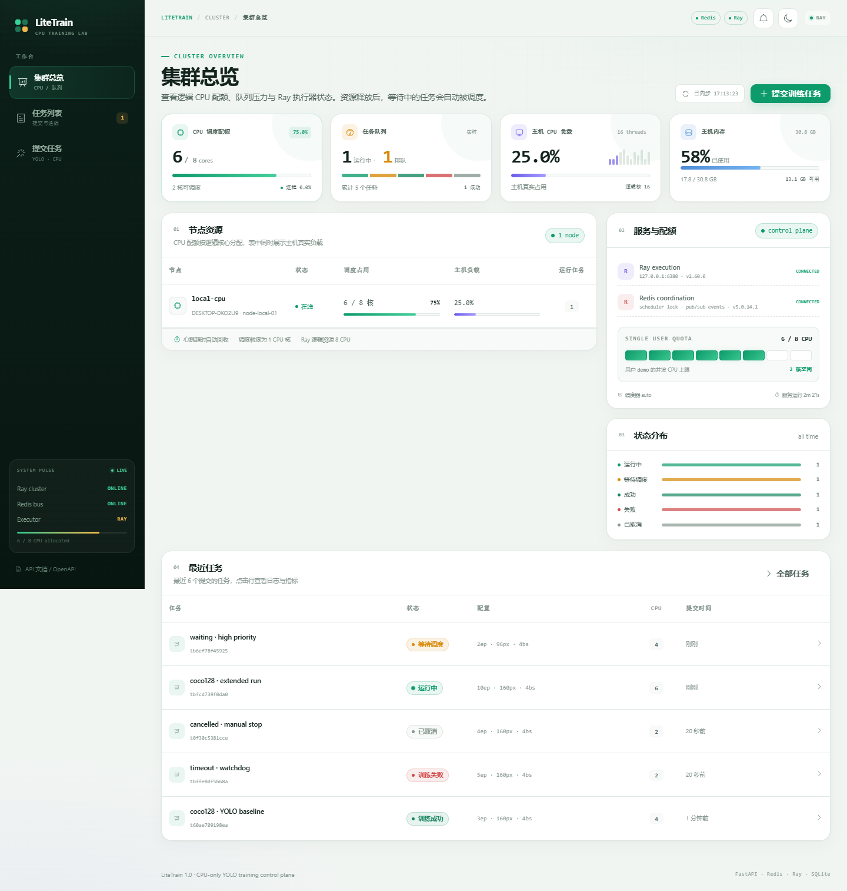
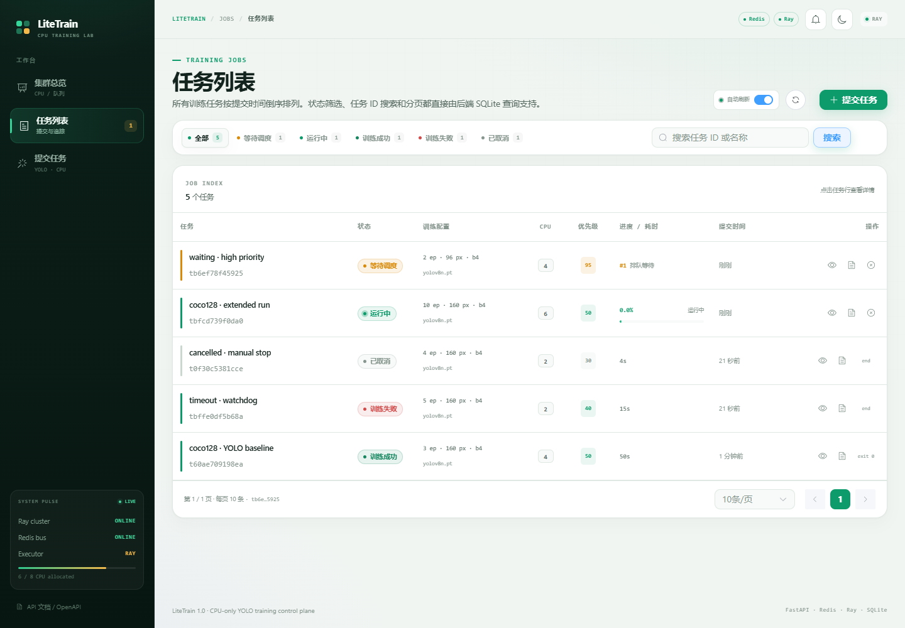
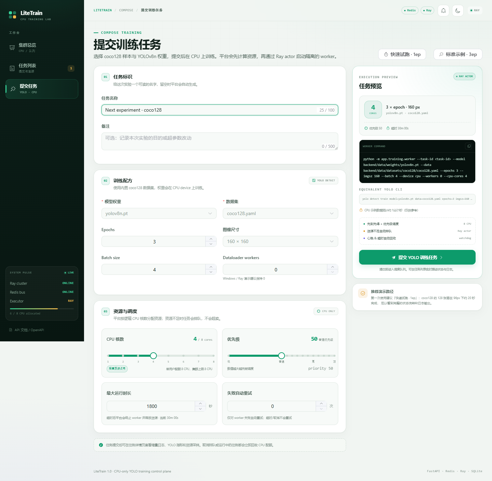
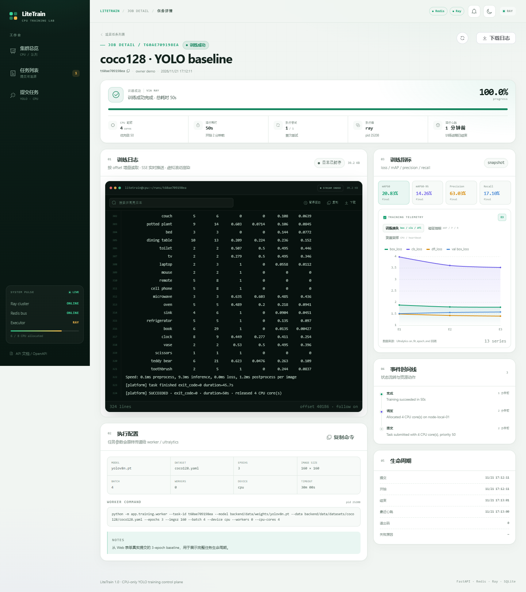
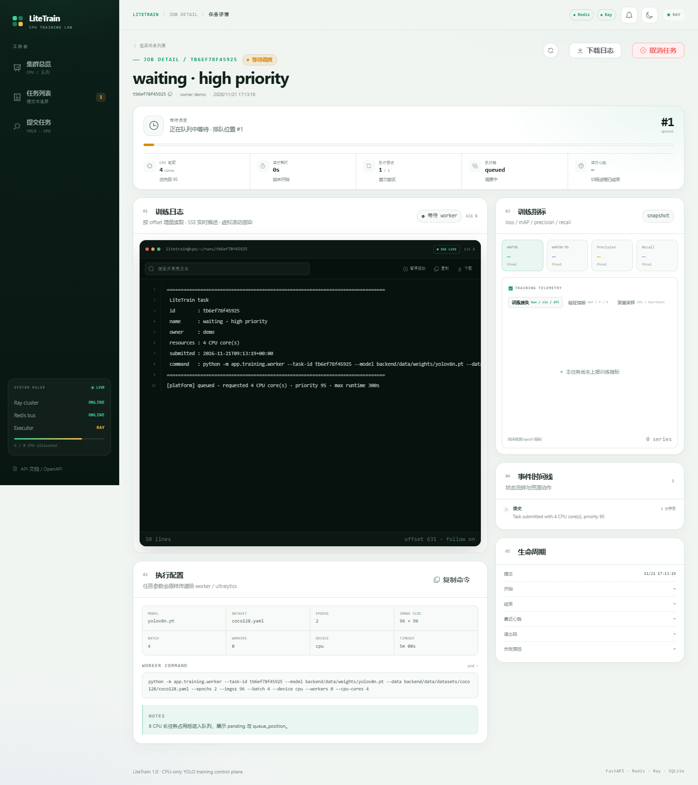
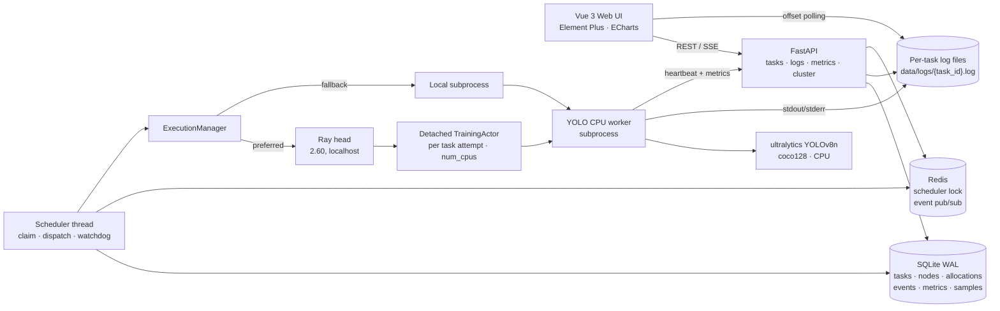
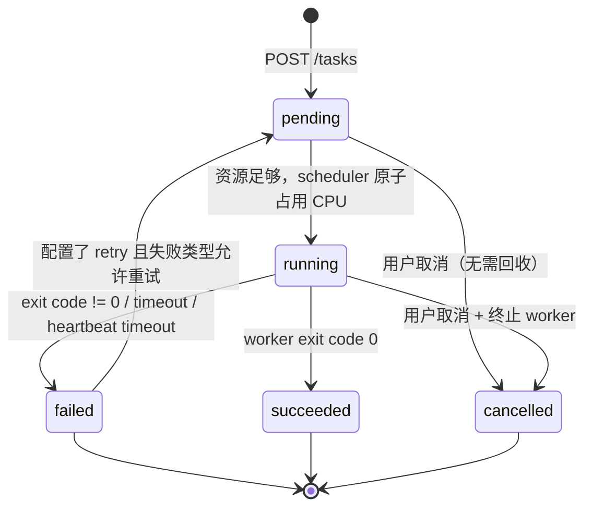

# LiteTrain · 带 Web 界面的轻量化 CPU YOLO 训练平台

LiteTrain 是一个前后端分离的训练平台示例：在普通笔记本上提交、排队、运行、取消、观察 YOLO 训练任务。调度与执行全部在本地完成，**CPU-only**，不使用 GPU、NCCL 或 DDP。

技术栈：**FastAPI + SQLite + Redis + Ray + ultralytics YOLO**；前端 **Vue 3 + Vite + TypeScript + Element Plus + ECharts**。

> 目标不是做一个“大而全”的 MLOps 平台，而是把训练任务的生命周期、资源回收、心跳、日志与指标这些**真正容易出错的地方**做完整、可演示、可测试。

---

## 目录

- [功能概览](#功能概览)
- [界面截图](#界面截图)
- [架构](#架构)
- [快速开始](#快速开始)
- [任务生命周期](#任务生命周期)
- [核心设计](#核心设计)
- [HTTP 接口](#http-接口)
- [配置项](#配置项)
- [测试与验收](#测试与验收)
- [P2 设计](#p2-设计)
- [已知边界](#已知边界)
- [第三方资产与许可](#第三方资产与许可)

---

## 功能概览

### P0

| 能力 | 实现 |
| --- | --- |
| 任务提交 / 分页查询 / 详情 / 取消 | `POST/GET /api/v1/tasks`，`GET /api/v1/tasks/{id}`，`POST /api/v1/tasks/{id}/cancel` |
| CPU 资源管控与排队 | SQLite 分配记录 + 1 CPU 粒度调度；资源不足保持 `pending`，释放后自动派发 |
| 任务状态流转 | `pending / running / succeeded / failed / cancelled`；正常退出码 0 = 成功，非 0 = 失败 |
| Worker 心跳与僵死检测 | worker 每 4s 回调 API；超过 25s 无心跳由 watchdog 终止并回收 CPU |
| 最大运行时长 | 每个任务独立 `max_runtime_seconds`，watchdog 到点强制终止并标记失败 |
| 日志持久化 + 增量读取 | 每个任务一个 UTF-8 日志文件；按字节 offset 读取；额外提供 SSE 流 |
| 元数据持久化 | SQLite（WAL）保存任务、节点、资源分配、指标、采样和事件；API 重启后恢复运行中的 Ray actor |
| 前端 4 个页面 | 集群总览、任务列表、提交任务、任务详情 & 日志 |
| 日志终端 | 虚拟滚动、自动滚动/暂停、关键词高亮、复制、下载完整日志 |
| 集群总览 | CPU 卡片、节点表、CPU 占用进度条、主机真实负载、队列/配额/服务状态 |

### P1

| 能力 | 实现 |
| --- | --- |
| 优先级调度 | `priority 0–100`，高优先级先调度；未实现抢占（题目中可选） |
| 抢占（可选） | 未实现；设计上可通过终止低优先级任务并重排队实现 |
| YOLO 指标 | Ultralytics `on_fit_epoch_end` 回调采集 loss / mAP / precision / recall / lr；存 SQLite；前端 ECharts 折线图 |
| 失败自动重试 | `max_retries` 0–5；worker 异常、非 0 退出、启动失败可自动重试；超时/心跳超时/手动取消不重试 |
| 单用户 CPU 配额 | `LITETRAIN_USER_CPU_QUOTA`；资源服务同时检查节点空闲量和用户已用量 |
| 资源采样 | worker 随心跳上报进程树 CPU% / RSS / 进程数；任务级时间序列 |
| 日志关键词高亮 | 终端内搜索高亮，不改变原始日志 |
| 浏览器通知 | 可选开启；任务变为终态时通过 Notification API 通知 |
| 深色模式 | Element Plus dark + 自定义主题变量；保存到 localStorage |
| 日志虚拟滚动 | 固定行高窗口化渲染，最多保留最近 25,000 行，避免大日志卡顿 |

### 额外实现

- **SSE 实时日志**：`GET /api/v1/tasks/{id}/logs/stream?offset=...`。
- **Ray detached actor**：API 重启后，运行中的训练 worker 不中断，API 能重新附着。
- **本地执行降级**：Ray 不可用时自动切换为本地子进程，页面仍可演示，服务状态会明确显示降级。
- **Redis 降级**：Redis 不可用时使用进程内调度锁；Redis 在线时使用分布式短锁和事件 pub/sub。
- **运行事件时间线**：调度、启动、重试、心跳恢复、取消、完成均可追溯。
- **自动资源回收**：成功、失败、超时、心跳超时、取消、API 重启对账都会释放过期 allocation。

---

## 界面截图

### 集群总览



### 任务列表



### 提交任务



### 任务详情与日志



### 队列与实时状态



> 截图由本机真实运行中的 `npm run dev` + FastAPI + Ray 页面生成，使用 Playwright 驱动 Edge，1440×1000 视口。说明见 [docs/screenshots/README.md](docs/screenshots/README.md)。
---

## 架构



### 为什么是 Ray Core detached actor，而不是只在 API 进程内跑训练？

- Ray 负责 worker 的**进程隔离**和逻辑 CPU 预留（`num_cpus`）。
- actor 以 `lifetime="detached"`、确定性名字创建，API 重启后仍可 `ray.get_actor()` 找到它。
- 平台自己维护 SQLite 的 CPU 配额账本，不依赖 Ray 的内部状态展示队列；两边 CPU 预算保持一致（本例都是 8）。
- 没有把调度逻辑交给外部成品平台页面，也没有嵌入任何第三方训练平台 UI。

### 关键文件

| 路径 | 作用 |
| --- | --- |
| `backend/app/services/scheduler.py` | 调度、超时/心跳 watchdog、状态机、取消、重启恢复 |
| `backend/app/services/resources.py` | CPU 账本、用户配额、集群快照 |
| `backend/app/services/executors.py` | Ray detached actor / 本地子进程执行后端 |
| `backend/app/services/ray_actor.py` | 在 Ray actor 中启动并监管训练 worker |
| `backend/app/training/worker.py` | YOLO CPU 训练、心跳、资源采样、指标上报、原子 result |
| `backend/app/services/logs.py` | 独立日志文件、ANSI 清理、offset 增量读取 |
| `backend/app/services/tasks.py` | 任务 CRUD、队列位置、指标/事件查询 |
| `backend/app/api/tasks.py` | 任务 API + SSE |
| `backend/app/api/internal.py` | worker 心跳和指标内部接口 |
| `frontend/src/views/OverviewView.vue` | 集群总览 |
| `frontend/src/views/TaskListView.vue` | 任务列表、筛选、分页、取消 |
| `frontend/src/views/TaskSubmitView.vue` | 任务表单与命令预览 |
| `frontend/src/views/TaskDetailView.vue` | 详情、终端、指标、事件 |
| `frontend/src/components/LogTerminal.vue` | SSE + 增量轮询 + 虚拟滚动 + 高亮 |
| `frontend/src/components/MetricsPanel.vue` | YOLO/资源折线图 |

---

## 快速开始

> Windows 如果提示“无法加载文件，因为在此系统上禁止运行脚本”，先仅在当前终端放开执行策略：
>
> ```powershell
> Set-ExecutionPolicy -Scope Process -ExecutionPolicy Bypass
> ```

### 0. 环境要求

- **Python 3.11–3.13**（本文在 Python 3.13.5 验证）
- **Node.js ≥ 20.19**（本文在 Node 24.20、Vite 8 验证）
- **Redis ≥ 5**（本文在 Windows Redis 5.0.14 验证；低版本请保持 `LITETRAIN_REDIS_PROTOCOL=2`）
- **Ray 2.60**（Windows / Linux；`requirements.txt` 已指定 `ray[default]`）
- 仅 CPU。无需 GPU、CUDA、NCCL 或 DDP。

### 1. 安装依赖

Windows PowerShell：

```powershell
.\scripts\setup.ps1
```

或手动执行：

```powershell
python -m venv .venv
.\.venv\Scripts\python -m pip install --upgrade pip
.\.venv\Scripts\pip install torch torchvision --index-url https://download.pytorch.org/whl/cpu
.\.venv\Scripts\pip install -r backend\requirements-dev.txt
.\.venv\Scripts\python scripts\download_assets.py   # 仓库已带资产时是幂等的
cd frontend
npm install
```

> 仓库已包含 `backend/data/weights/yolov8n.pt` 和 `backend/data/datasets/coco128`，正常情况下不需要联网下载。`download_assets.py` 使用 GitHub / ghproxy / hf-mirror 多镜像，方便重新准备资产。

### 2. 启动 Redis

如果本机已安装 Redis：

```powershell
Get-Service redis
# 未运行时：Start-Service redis
```

或用 Docker：

```bash
docker run --rm -p 6379:6379 redis:7-alpine
```

Redis 只用于调度锁和事件广播；即使 Redis 不可用，平台也能运行，只是集群页会显示降级。

### 3. 启动 Ray（推荐）

```powershell
.\scripts\start_ray.ps1
```

它等价于：

```powershell
$env:RAY_ENABLE_UV_RUN_RUNTIME_ENV = "0"
$env:RAY_AUTH_MODE = "disabled"
$env:PYTHONPATH = "D:\path\to\repo\backend"
ray start --head --num-cpus=8 --port=6380 `
  --dashboard-host=127.0.0.1 --dashboard-port=8265 --disable-usage-stats
```

- Ray GCS 使用 **6380**，避免和 Redis 默认的 6379 冲突。
- Dashboard/Jobs API 使用 **8265**。
- `LITETRAIN_TOTAL_CPUS` 应与启动 Ray 时的 `--num-cpus` 一致（默认都是 8）。
- 停止：`.\scripts\start_ray.ps1 -StopRay`。
- Windows 上 Ray 2.60 需要设置 `RAY_ENABLE_UV_RUN_RUNTIME_ENV=0`；脚本已经处理。若手工启动遇到 `psutil.NoSuchProcess`/`is_repeated` 相关问题，请确认使用的是仓库环境里的 ray 2.60，并执行过 `pip install "ray[default]==2.60.0"`。

不启动 Ray 也可以：`LITETRAIN_EXECUTION_MODE=local` 时使用本地子进程。**但默认 `auto` 会优先 Ray**。

### 4. 启动后端

```powershell
.\scripts\start_backend.ps1
```

- API：<http://127.0.0.1:8000>
- Swagger：<http://127.0.0.1:8000/docs>
- 健康检查：<http://127.0.0.1:8000/healthz>

### 5. 启动前端（开发模式）

```powershell
.\scripts\start_frontend.ps1
```

- UI：<http://127.0.0.1:5173>
- Vite 把 `/api`、`/docs`、`/openapi.json`、`/healthz` 代理到 `127.0.0.1:8000`。

### 6. 生产构建（可选）

```powershell
cd frontend
npm run build
# 重启后端
.\scripts\start_backend.ps1
```

FastAPI 会自动托管 `frontend/dist`，此时可以直接访问 <http://127.0.0.1:8000>（`LITETRAIN_SERVE_FRONTEND=true`）。

### 7. Linux / macOS 手动启动

Windows 脚本本质上也是以下命令；在 Linux/macOS 上可以分别打开多个终端执行：

```bash
# 准备（仓库根目录）
python3 -m venv .venv
source .venv/bin/activate
pip install torch torchvision --index-url https://download.pytorch.org/whl/cpu
pip install -r backend/requirements-dev.txt
python scripts/download_assets.py

# Redis
redis-server --daemonize yes

# Ray 终端
source .venv/bin/activate
export RAY_ENABLE_UV_RUN_RUNTIME_ENV=0
export RAY_AUTH_MODE=disabled
export PYTHONPATH="$PWD/backend"
ray start --head --num-cpus=8 --port=6380 \
  --dashboard-host=127.0.0.1 --dashboard-port=8265 --disable-usage-stats

# FastAPI 终端
source .venv/bin/activate
PYTHONPATH=backend uvicorn app.main:app --host 127.0.0.1 --port 8000

# Vue 终端
cd frontend
npm install
npm run dev
```

### 8. 第一次任务

1. 打开 `提交训练任务`。
2. 点击 **快速试跑 · 1ep**，或保留默认 3 epochs / 160px。
3. 点击 **提交 YOLO 训练任务**。
4. 在任务详情页观察日志与指标；约 20–60 秒可看到 `succeeded`。
5. 回到总览可看到 CPU 分配从 0 恢复为 0，资源已释放。

---

## 任务生命周期



### 一次正常执行的内部顺序

1. `POST /tasks` 写入 SQLite，状态 `pending`，创建 `data/logs/{id}.log` 和 `data/runs/{id}/result.json` 路径。
2. Scheduler 每 1s 拿 Redis 短锁；按 `priority DESC, submitted_at ASC` 扫描 pending。
3. 资源足够时创建 `ResourceAllocation(active)`，状态原子更新为 `running`。
4. `ExecutionManager` 创建 Ray detached actor（`num_cpus = task.cpu_cores`），actor 启动 `python -m app.training.worker` 子进程。
5. Worker：
   - 启动心跳线程（每 4s）；
   - 上报进程 CPU/内存/epoch 进度；
   - 训练过程中通过 `on_fit_epoch_end` 调用指标接口；
   - 退出时原子写 `result.json`，再由 worker 的 `os._exit` 保证退出码。
6. Scheduler 观察到 `result.json`：exit 0 → `succeeded`，非 0 → `failed`。
7. 释放 allocation，清理 actor；如有下一次排队任务，下一 tick 自动调度。

### 取消

- pending：直接标 cancelled，无 allocation。
- running：`ExecutionManager.stop` 终止 worker 进程树（Ray actor 的 `stop` + PID 兜底）→ 释放 allocation → 标 cancelled。
- 也可以取消排队任务，使其不占用队首。

### 超时与僵死

- 任务超时：`now - started_at > max_runtime_seconds` → 终止 + `failed / runtime_timeout`。
- Worker 僵死：`now - last_heartbeat_at > 25s` → 终止 + `failed / heartbeat_timeout`。
- Worker 进程消失且没有 result：`failed / worker_exited_without_result`。
- 所有路径最终都会调用 `release_allocation`，资源看板立即回落。

### 重试

- 任务创建时可配置 `max_retries`（0–5）。
- 失败后若可重试：
  - `retry_count += 1`，状态回到 `pending`；
  - 删除旧的 `result.json`，避免新 attempt 误读上次结果；
  - 清理旧 epoch metrics；
  - 保留原日志，追加 attempt 分隔线和 `retrying` 信息；
  - 下一次调度重新分配 CPU。
- 超时、心跳超时和手动取消不重试，避免死循环。

### 重启恢复

- 所有任务状态、分配、节点、事件、指标都在 SQLite。
- API 重启时 `Scheduler.recover()`：
  - 有 `result.json` 的运行任务直接结算；
  - PID/actor 尚在的运行任务重新附着，并刷新心跳窗口；
  - 找不到 worker 的运行任务标记失败并按规则重试；
  - 为非 running 任务清理孤儿 allocation。
- **已实测**：运行任务的 4 CPU allocation 在 API 重启后仍然存在，worker 继续训练并成功完成。

---

## 核心设计

### 资源账本

- 调度只承认两种资源事实：节点总 CPU 和 active allocation 之和。
- 调度时同时检查：
  - `node.total - SUM(active.cpus)`；
  - `user_quota - SUM(active.cpus for owner)`。
- 任务申请 CPU 大于节点或用户配额时在提交阶段直接 422。
- 使用 SQLite 事务 + `running` 状态检查防止同一任务双启动；Redis 短锁避免多 API 实例同时调度。

### 日志

- 每个任务独立日志：`backend/data/logs/{task_id}.log`。
- `GET /tasks/{id}/logs?offset=&limit=` 返回：
  - `content`：清理 ANSI、`\r` 规整后的文本；
  - `start_offset` / `next_offset` / `file_size` / `eof`。
- 前端初始只拉取 128KB，之后通过 SSE 增量接收；SSE 断开自动退回 offset 轮询。
- 终端虚拟化：只渲染视口内行，固定行高 22px，最多保留 25,000 行。
- 前端“复制”为已加载内容；下载按钮返回完整原始日志。

### 指标

- 训练指标接口：`POST /api/v1/internal/tasks/{id}/metrics`（worker token header）。
- 指标来自 Ultralytics 回调，包含：
  - `train/box_loss`, `train/cls_loss`, `train/dfl_loss`
  - `val/box_loss`, `val/cls_loss`, `val/dfl_loss`
  - `metrics/mAP50(B)`, `metrics/mAP50-95(B)`, `metrics/precision(B)`, `metrics/recall(B)`
  - `lr/pg0` 等
- 前端按 epoch 绘制 loss、mAP/precision/recall、CPU 资源曲线。

### Ray 与本地降级

- `LITETRAIN_EXECUTION_MODE=auto`：先检查 Ray GCS 端口并 `ray.init(address=...)`；失败则使用本地子进程。
- 成功时在顶部/总览中显示 `RAY`；降级时显示 `LOCAL`。
- 两种执行器使用同一个 `app.training.worker`，因此日志、心跳、指标、重试逻辑完全一致。

### 为什么用 SQLite 而不是 Postgres？

- 作业要求明确列出 SQLite；本项目是单节点演示，SQLite + WAL 足以支撑每秒级调度。
- 所有写入都使用短事务；查询/列表走索引。多 API 实例的调度互斥由 Redis 提供，但 SQLite 仍是单机数据库，不是分布式数据库。
- P2 多节点方案会把元数据替换为 Postgres/MySQL，见下文。

---

## HTTP 接口

Base：`http://127.0.0.1:8000/api/v1`；完整 OpenAPI 在 `/docs`。

### 任务

| 方法 | 路径 | 说明 |
| --- | --- | --- |
| `POST` | `/tasks` | 提交任务，返回 201 + task |
| `GET` | `/tasks` | 分页列表，支持 `page`, `page_size`, `status`, `q`, `sort_by`, `sort_order` |
| `GET` | `/tasks/options` | 模型/数据集选项、CPU 与配额上限、默认表单值 |
| `POST` | `/tasks/preview` | 生成 worker 命令与等效 YOLO CLI |
| `GET` | `/tasks/{id}` | 任务详情（含 queue_position、运行时长、资源最新值） |
| `POST` | `/tasks/{id}/cancel` | 取消任务（排队或运行） |
| `GET` | `/tasks/{id}/logs` | `offset` 增量日志；`limit≤1MB` |
| `GET` | `/tasks/{id}/logs/stream` | SSE 实时日志，支持 `offset` |
| `GET` | `/tasks/{id}/logs/download` | 下载完整日志 |
| `GET` | `/tasks/{id}/events` | 事件时间线 |
| `GET` | `/tasks/{id}/metrics` | YOLO series + 资源采样 + final metrics |

### 集群

| 方法 | 路径 | 说明 |
| --- | --- | --- |
| `GET` | `/cluster/overview` | CPU/内存/队列/节点/配额/Ray/Redis |
| `GET` | `/cluster/health` | 健康检查 |
| `GET` | `/version` | 版本、执行器、scheduler 后端信息 |

### Worker 内部回调

这些接口要求 header `X-Worker-Token`；token 在任务创建时生成，不返回给前端。

| 方法 | 路径 | 说明 |
| --- | --- | --- |
| `POST` | `/internal/tasks/{id}/heartbeat` | 心跳 + CPU/内存采样 + 进度 |
| `POST` | `/internal/tasks/{id}/metrics` | epoch 指标批量入库（幂等） |

### curl 示例

```bash
# 提交 1 epoch 的快速任务
curl -X POST http://127.0.0.1:8000/api/v1/tasks \
  -H "Content-Type: application/json" \
  -d '{
    "name": "coco128 smoke",
    "model": "yolov8n.pt",
    "dataset": "coco128.yaml",
    "epochs": 1,
    "imgsz": 96,
    "batch_size": 4,
    "workers": 0,
    "cpu_cores": 4,
    "priority": 50,
    "max_runtime_seconds": 300,
    "max_retries": 0
  }'

curl http://127.0.0.1:8000/api/v1/tasks?page=1&page_size=10
curl "http://127.0.0.1:8000/api/v1/tasks/<id>/logs?offset=0&limit=32768"
curl -N "http://127.0.0.1:8000/api/v1/tasks/<id>/logs/stream?offset=0"
curl http://127.0.0.1:8000/api/v1/tasks/<id>/metrics
```

### 日志 offset 语义

- offset 以**原始日志文件的字节数**计。
- 返回的 `content` 做了 ANSI/回车清理，所以 `len(content)` 不等于 `next_offset - start_offset`；客户端必须使用 `next_offset` 续读。
- 这是有意的：文件 raw offset 稳定，展示层可安全清理控制字符。

---

## 配置项

配置文件：`backend/.env`（从 `backend/.env.example` 复制）；所有变量带 `LITETRAIN_` 前缀。

| 变量 | 默认 | 说明 |
| --- | --- | --- |
| `LITETRAIN_DATABASE_URL` | `sqlite:///backend/data/platform.db` | 元数据库 |
| `LITETRAIN_TOTAL_CPUS` | `8` | 平台逻辑 CPU 池 |
| `LITETRAIN_USER_CPU_QUOTA` | `8` | 单用户并发 CPU 上限 |
| `LITETRAIN_EXECUTION_MODE` | `auto` | `auto / ray / local` |
| `LITETRAIN_RAY_GCS_ADDRESS` | `127.0.0.1:6380` | Ray head GCS |
| `LITETRAIN_RAY_NAMESPACE` | `litetrain` | detached actor namespace |
| `LITETRAIN_REDIS_URL` | `redis://127.0.0.1:6379/0` | Redis |
| `LITETRAIN_REDIS_PROTOCOL` | `2` | 兼容 Redis 5 |
| `LITETRAIN_HEARTBEAT_INTERVAL_SECONDS` | `4` | worker 心跳周期 |
| `LITETRAIN_HEARTBEAT_TIMEOUT_SECONDS` | `25` | 心跳超时阈值 |
| `LITETRAIN_DEFAULT_MAX_RUNTIME_SECONDS` | `1800` | 表单默认超时 |
| `LITETRAIN_WORKER_API_BASE` | `http://127.0.0.1:8000/api/v1` | worker 回调地址 |
| `LITETRAIN_WORKER_PYTHON` | 当前解释器 | 实际训练用的 venv Python |
| `LITETRAIN_SERVE_FRONTEND` | `true` | dist 存在时由 FastAPI 托管 |
| `LITETRAIN_CORS_ORIGINS` | `http://localhost:5173,...` | 开发跨域白名单 |

完整默认值见 `backend/app/config.py`。

---

## 测试与验收

### 自动测试

```powershell
cd backend
..\.venv\Scripts\python -m pytest
```

结果：**19 passed**。测试覆盖：

- 创建、分页、状态筛选、ID/名称搜索；
- 表单选项和命令预览；
- 增量日志 offset 与 ANSI 清理；
- worker 心跳鉴权、指标幂等入库；
- 取消 pending / running 与 409 冲突；
- 超时失败与 allocation 回收；
- 心跳超时失败与回收；
- 正常退出成功；
- 非 0 退出自动重试、二次失败终态；
- 资源容量、用户配额与优先级队列位置；
- 非法 CPU/缺失资产 422、缺失任务 404。

### 黑盒联调（可选）

先启动 Ray、Redis、后端，再执行：

```powershell
.\.venv\Scripts\python scripts\e2e_live.py
```

它会实际提交 3 个任务，验证：

1. 6 CPU 长任务运行，4 CPU 高优先级任务排队；
2. 集群返回 `allocated=6 / available=2`；
3. SSE 能读到日志；
4. 取消运行中任务，排队任务自动启动；
5. 15s 超时任务被 watchdog 终止，allocation 降到 0。

本机实测结果：

```text
queue evidence: allocated=6, available=2, pending=1, queue_position=1
after cancel:    runner=running, allocated=4
timeout evidence: status=failed, reason=runtime_timeout, runtime=15, allocated_after=4
runner final:    status=succeeded, runtime=25
metric series:   train/box_loss, metrics/mAP50(B), ...
E2E OK
```

### 重启恢复实测

运行一个 8 epoch 任务，在训练进行中杀掉 FastAPI 进程并重启：

```text
BEFORE_RESTART status=running progress=2.0 hb=...35.212Z
AFTER_RESTART  status=running progress=12.5 hb=...52.705Z allocated=4
LATER          status=succeeded runtime=91s
```

说明：Ray detached actor + SQLite allocation 持久化确实让训练继续，API 重新附着并继续心跳判定。

### 截图

最终截图位于 `docs/screenshots/`，使用 Playwright 驱动本机 Edge，对真实运行中的页面截图：

- 浅色模式总览 / 列表 / 提交 / 详情；
- 队列与运行中状态；
- 深色模式。

---

## P2 设计

完整说明见 [docs/p2-design.md](docs/p2-design.md)。

1. **多节点集群模拟**：Ray autoscaler 或静态 head+worker；节点通过 Redis/心跳注册；调度器以节点为维度计算可用 CPU，并允许通过 Ray custom resources 做 GPU/标签亲和。元数据迁移到 Postgres，API 无状态多副本。
2. **流水线编排**：预处理 → 训练 → 评估由任务依赖 DAG 表达；每个阶段是一个可重试任务，产物通过版本化 URI 传递；调度器按 DAG 入度和资源同时满足时推进。
3. **数据与模型管理**：对象存储（MinIO/S3）+ 元数据表；数据集版本、内容哈希、YAML spec；训练输出 run 目录/权重注册、预签名下载、保留策略。
4. **Webhook**：状态事件先写 outbox（SQLite/Postgres），后台 dispatcher 做带 HMAC 签名的 HTTP 推送、指数退避、去重和失败死信；Webhook 配置按事件类型/任务过滤。

这些设计在代码中预留了事件表、产物路径和节点抽象，但**未编码实现**，符合题目 P2 要求。

---

## 已知边界

- **单节点**：当前只注册了一个本地节点；资源账本支持 node_id 字段，但 UI/调度默认单节点。
- **无鉴权/多租户**：题目是单用户演示；生产需要 OIDC/JWT、任务级权限和审计。
- **无抢占**：优先级只影响尚未启动的任务；P1 的可选低优先级抢占未实现。
- **SQLite**：适合单节点演示，不适合多 API 实例共享；P2 多节点需迁移到 Postgres。
- **本地子进程模式**：在没有 Ray 时可用，但没有 Ray 的进程隔离和逻辑资源预留；平台仍按账本限制。
- **Windows**：使用 Redis 5 时必须 `protocol=2`；训练进程需要 `KMP_DUPLICATE_LIB_OK=TRUE`（执行器自动设置）；Ray 启动由 `scripts/start_ray.ps1` 处理环境变量。
- **不嵌入第三方平台**：没有 Kubeflow/Cube Studio/Airflow 页面或 iframe。
- **CPU-only**：worker 强制 `device=cpu`，Ray actor 仅申请 CPU 资源。

---

## 第三方资产与许可

- 代码：MIT，见 [LICENSE](LICENSE)。
- `yolov8n.pt` 权重与 `coco128` 数据集来自 [Ultralytics assets](https://github.com/ultralytics/assets)，分别遵循其仓库/数据集许可；`backend/data/datasets/coco128/LICENSE` 是原始 COCO128 许可文件。
- 使用 ultralytics 时请遵守其 AGPL-3.0 许可要求。

---

## 仓库结构

```text
.
├─ backend/
│  ├─ app/
│  │  ├─ api/            # tasks, internal callbacks, cluster
│  │  ├─ services/       # scheduler, resources, logs, executors, Ray actor
│  │  ├─ training/       # worker + command/asset resolution
│  │  ├─ config.py
│  │  ├─ database.py
│  │  ├─ models.py
│  │  ├─ schemas.py
│  │  └─ main.py
│  ├─ data/              # demo assets, logs, runs, SQLite
│  ├─ tests/
│  ├─ requirements.txt
│  └─ pytest.ini
├─ frontend/
│  ├─ src/
│  │  ├─ views/          # 4 pages
│  │  ├─ components/     # terminal, metrics, status
│  │  ├─ layout/
│  │  ├─ api/
│  │  └─ router/
│  ├─ vite.config.ts
│  └─ package.json
├─ scripts/              # setup / start / asset download / live e2e
├─ docs/                 # screenshots, P2 design
└─ README.md
```
