# LiteTrain · 带 Web 界面的轻量化 CPU YOLO 训练平台

[](https://github.com/gaoxuyang914/litetrain/actions/workflows/ci.yml)
[](https://github.com/gaoxuyang914/litetrain/blob/main/LICENSE)

LiteTrain 是一个前后端分离的训练平台示例：在普通笔记本上提交、排队、运行、取消、观察 YOLO 训练任务。调度与执行全部在本地完成，**CPU-only**，不使用 GPU、NCCL 或 DDP。

技术栈：**FastAPI + SQLite + Redis + Ray + ultralytics YOLO**；前端 **Vue 3 + Vite + TypeScript + Element Plus + ECharts**。

> 目标不是做一个“大而全”的 MLOps 平台，而是把训练任务的生命周期、资源回收、心跳、日志、指标，以及 P2 要求的流水线、资产和 Webhook 这些**真正容易出错的地方**做完整、可演示、可测试。

**当前状态**：P0 / P1 全部完成；P2 四项高阶能力（多节点模拟、预处理 → 训练 → 评估流水线、数据集与模型产物、状态 Webhook）也已编码实现，并通过真实 Ray 训练、真实 HTTP 回调完成验收。v2.5 将界面调整为零依赖的 **Ultralytics Platform 风格浅色工作区**：白色侧栏、蓝色品牌、细边框卡片、黑色主按钮和任务搜索。

> CPU 优化的落地路线、现状差距、里程碑和验收指标见 [docs/CPU_OPTIMIZATION_LANDING_PLAN.md](docs/CPU_OPTIMIZATION_LANDING_PLAN.md)。

## 交付物对照

| 交付物 | 位置 / 验证 |
| --- | --- |
| 完整 Git 仓库 | [github.com/gaoxuyang914/litetrain](https://github.com/gaoxuyang914/litetrain)，`main` 分支，提交历史与版本标签见仓库 |
| README | 本文件：环境依赖、快速开始、架构图、HTTP 接口、测试与验收、已知边界 |
| 可运行演示 | `scripts/setup.ps1` → `scripts/start_ray.ps1` → `scripts/start_backend.ps1` → `scripts/start_frontend.ps1`；黑盒验收脚本 `scripts/e2e_live.py` |
| 规格与设计文档 | [docs/README.md](docs/README.md)：SDD 需求规格、技术实现设计、TDD 测试规格与验收矩阵 |
| 答辩讲稿 | [答辩讲稿.md](答辩讲稿.md)：项目定位、8 分钟讲稿、演示脚本、技术亮点与 Q&A |
| 演示截图 | [docs/screenshots](docs/screenshots/README.md)，32 张真实运行截图 |
| CI | [.github/workflows/ci.yml](.github/workflows/ci.yml)，GitHub Actions 后端测试 + 平台/后台前端 typecheck/build |

---

## 目录

- [功能概览](#功能概览)
- [交付物对照](#交付物对照)
- [界面截图](#界面截图)
- [架构](#架构)
- [快速开始](#快速开始)
- [任务生命周期](#任务生命周期)
- [核心设计](#核心设计)
- [P2 高阶能力实现](#p2-高阶能力实现)
- [HTTP 接口](#http-接口)
- [配置项](#配置项)
- [测试与验收](#测试与验收)
- [已知边界](#已知边界)
- [第三方资产与许可](#第三方资产与许可)
- [仓库结构](#仓库结构)

---

## 功能概览

### P0（必做）

| 能力 | 实现 |
| --- | --- |
| 任务提交 / 分页查询 / 详情 / 取消 | `POST/GET /api/v1/tasks`，`GET /api/v1/tasks/{id}`，`POST /api/v1/tasks/{id}/cancel` |
| CPU 资源管控与排队 | SQLite 分配记录 + 1 CPU 粒度调度；资源不足保持 `pending`，释放后自动派发 |
| 5 种任务状态 | `pending / running / succeeded / failed / cancelled`；退出码 0 = 成功，非 0 = 失败 |
| Worker 心跳与僵死检测 | worker 每 4s 回调 API；超过 25s 无心跳由 watchdog 终止并回收 CPU |
| 最大运行时长 | 每个任务独立 `max_runtime_seconds`，watchdog 到点强制终止并标记失败 |
| 日志持久化 + 增量读取 | 每个任务一个 UTF-8 日志文件；按字节 offset 读取；额外提供 SSE 流 |
| 元数据持久化 | SQLite（WAL）保存任务、节点、资源分配、指标、采样和事件；API 重启后恢复运行中的 Ray actor |
| 前端 4 个 P0 页面 | 集群总览、任务列表、提交任务、任务详情 & 日志 |
| 日志终端 | 虚拟滚动、自动滚动/暂停、关键词高亮、复制、下载完整日志 |
| 集群总览 | CPU 卡片、节点表、CPU 占用进度条、主机真实负载、队列/配额/服务状态 |

### P1（加分）

| 能力 | 实现 |
| --- | --- |
| 优先级调度与抢占 | `priority 0–100`，高优先级先调度；资源不足时可抢占低优先级任务：仅限有 checkpoint 的独立任务，原任务记为 `cancelled / preempted`，自动创建 resume 子任务；无 checkpoint、流水线任务或已抢占两次的任务不抢占 |
| YOLO 指标 | Ultralytics `on_fit_epoch_end` 回调采集 loss / mAP / precision / recall / lr；存 SQLite；前端 ECharts 折线图 |
| 失败自动重试 | `max_retries` 0–5；worker 异常、非 0 退出、启动失败可自动重试；超时/心跳超时/手动取消不重试 |
| 单用户 CPU 配额 | `LITETRAIN_USER_CPU_QUOTA`；同时检查节点空闲量和用户已用量；由后台「运行设置」动态调整 |
| 后台管理 | `http://127.0.0.1:5174`（独立端口）：管理员创建账号、分配角色（管理员/操作员/只读）、启停账号、重置密码，并集中修改运行设置；任务提交页不能超过后台设置的任务超时/重试上限 |
| 资源采样 | worker 随心跳上报进程树 CPU% / RSS / 进程数；任务级时间序列 |
| 日志关键词高亮 | 终端内搜索高亮，不改变原始日志 |
| 浏览器通知 | 可选开启；任务变为终态时通过 Notification API 通知 |
| 深色模式 | Element Plus dark + 自定义主题变量；保存到 localStorage |
| 日志虚拟滚动 | 固定行高窗口化渲染，最多保留最近 25,000 行，避免大日志卡顿 |

### P2（高阶方案，已实现）

| 能力 | 实现 |
| --- | --- |
| 多节点集群模拟 | 1–8 个逻辑节点，节点总容量不超过平台 CPU 预算；节点上线/离线，按节点空闲容量和最低利用率调度；总览页提供实时拓扑、节点上的运行 Task 预览和主机负载 |
| 预处理 → 训练 → 评估流水线 | 三条固定阶段，每阶段是普通 CPU Task；预处理做去重/校验/可复现切分，评估输出逐类 AP、阈值和延迟；前一阶段成功后自动创建下一阶段；失败/取消终止后续阶段 |
| 数据集管理 | 内置 COCO128 + ZIP 上传、YAML 校验、图片/标签统计、版本注册、原始归档下载、软删除 |
| 模型产物管理 | 扫描 `best.pt / last.pt / results.csv / args.yaml`，记录大小与 SHA-256，按任务/流水线查询并从 Web 下载 |
| 基础权重导入 | 资产页上传 `.pt` checkpoint，校验扩展名/文件头/重名/512 MB 上限并计算 SHA-256；导入后立即可在提交训练页选择 |
| 状态 Webhook | 注册 endpoint + 事件订阅；事务性 outbox；HMAC-SHA256 签名；指数退避重试；投递记录与手动测试 |
| 新增 Web 页面 | `训练流水线`、`数据与产物`（数据集 / 模型权重 / 产物 / Webhooks 四个 tab）；总览页增加多节点模拟和节点上下线操作 |

### v2.4 数据与实验闭环（P0 优化）

| 能力 | 实现 |
| --- | --- |
| 数据集质量体检 | 标签结构、坐标/类别、图片解码、缺失/孤儿标签、完全重复、train/val 泄漏、类别分布、小目标；严重问题阻断训练 |
| 训练准入 | `quality_status` + 警告确认；任务创建和流水线创建都会校验数据集 |
| CPU 参数压测 | 短周期实测 threads / workers，记录 images/s、耗时、峰值 RSS；结果持久化并返回推荐 profile，可一键带入提交页 |
| Checkpoint / Resume | 每轮保存 checkpoint、任务详情可查看；失败/取消后可人工从最近 checkpoint 创建新任务 |
| Run Manifest | 每次新任务记录数据哈希、模型哈希、配置、seed、Python/PyTorch/Ultralytics、Git 与主机信息 |
| 实验对比 | 任务列表选择 2–4 个任务，对比配置、数据集、mAP、耗时和峰值内存 |

> 本轮迁移使用 SQLite 可重复执行的加列迁移；旧的 `platform.db` 升级前已备份。P1/P2 的早停、错误分析、ONNX 和量化仍按路线图推进。

### v2.5 界面与运行观测

- 工作区改为 Ultralytics Platform 风格的浅色侧栏、蓝色品牌、细边框卡片和黑色主操作。
- 状态分布支持弹窗放大，并按 **5 分钟 / 15 分钟 / 30 分钟 / 1 小时 / 3 小时 / 6 小时 / 12 小时 / 24 小时 / 7 天 / 30 天 / 90 天 / 近半年 / 全部时间** 查询。
- 统计口径为任务提交时间，数据由 `/api/v1/cluster/task-distribution` 直接从 SQLite 聚合。
- 提交页只列出已登记数据集；未登记 YAML 即使存在于数据目录，也会被 **422** 拒绝，避免绕过质量检查。
- 任务详情可一键跳转到「模型产物」并按任务过滤；产物页支持按产物名、任务 ID、SHA-256 搜索和 kind 筛选。
- 已结束任务支持一键 **在原任务上重跑**：不创建新任务 ID，不追加 `· rerun` 名称，重跑时自动清理历史名称后缀；任务回到 `pending`，`attempt` 递增，原日志保留并追加 `MANUAL RERUN` 分隔线；任务详情展示每次运行历史。重跑会同步当前后台的**超时/重试上限**，不会沿用旧任务的限制快照。
- 失败/取消任务支持 **从断点继续**：选择具体 checkpoint，可选完整恢复（优化器、学习率、epoch 进度）或仅加载权重；数据集哈希变化会拒绝恢复。完整恢复结束后会把 `best.pt / last.pt / results.csv / args.yaml` 同步回新任务目录，保证产物页可见。
- **提交页数据准备融合**：数据质量与预处理策略放在同一个「数据准备」分区；打开「使用预处理策略」后可直接从提交页创建预处理 → 训练 → 评估流水线，质量警告在同一处确认。
- 流水线 **预处理 v2**：扫描原数据、SHA-256 去重、标签格式/类别/坐标校验，按固定种子做可复现训练/验证切分，输出图片统计、类别分布和丢弃原因报告。
- 流水线 **状态恢复**：阶段任务重跑会自动重开终态流水线；列表也支持「继续流水线」，按已完成阶段重新同步状态并继续后续阶段。
- 流水线 **评估 v2**：固定使用验证集 val，支持置信度/IoU/max-det，输出整体指标、逐类 AP50-95、CPU 延迟/FPS、阈值配置和 `evaluation.json` 报告；训练集不参与评估，避免指标失真。

### 额外实现

- **SSE 实时日志**：`GET /api/v1/tasks/{id}/logs/stream?offset=...`。
- **Ray detached actor**：API 重启后，运行中的训练 worker 不中断，API 能重新附着。
- **本地执行降级**：Ray 不可用时自动切换为本地子进程，页面仍可演示，服务状态会明确显示降级。
- **Redis 降级**：Redis 不可用时使用进程内调度锁；Redis 在线时使用分布式短锁和事件 pub/sub。
- **运行事件时间线**：调度、启动、重试、心跳恢复、取消、完成均可追溯。
- **自动资源回收**：成功、失败、超时、心跳超时、取消、API 重启对账都会释放过期 allocation。
- **多节点容量碎片化保护**：任务必须能落在单个节点上；提交阶段直接返回 422，不会无限排队。
- **Webhook 本地接收器**：`scripts/webhook_receiver.py`，无额外依赖，可直接演示签名头与 JSON body。

---

## 界面截图

### 集群总览（双节点模拟，实时拓扑 + 两个任务运行中 + 一个任务排队）


### 任务详情与训练指标


### 训练流水线

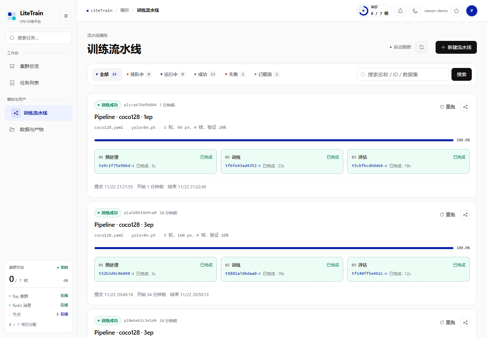

### 数据与产物

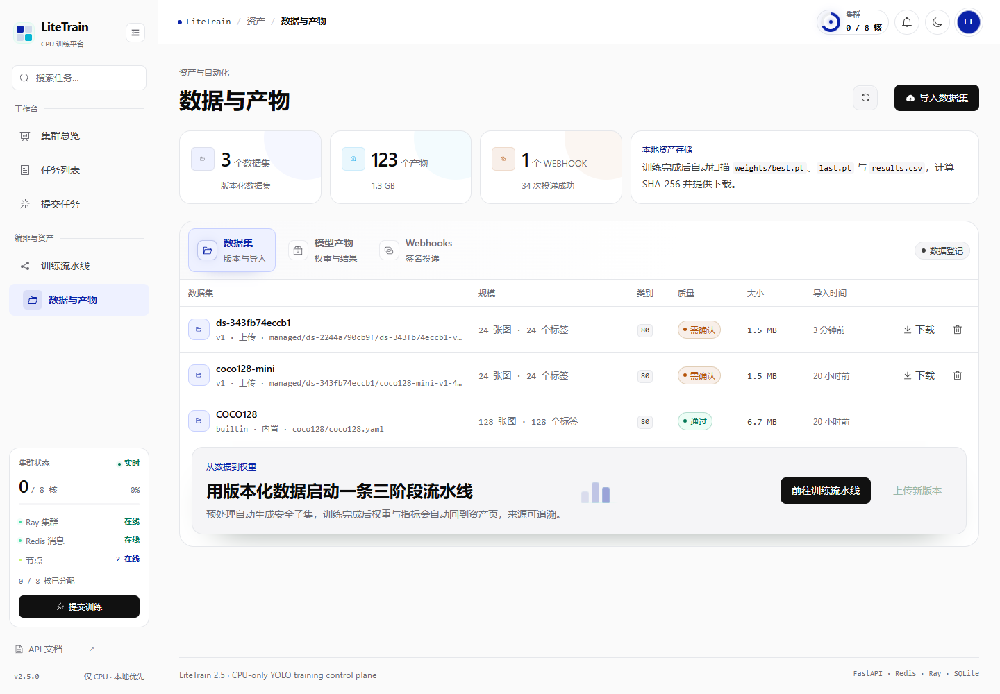

### 模型产物下载

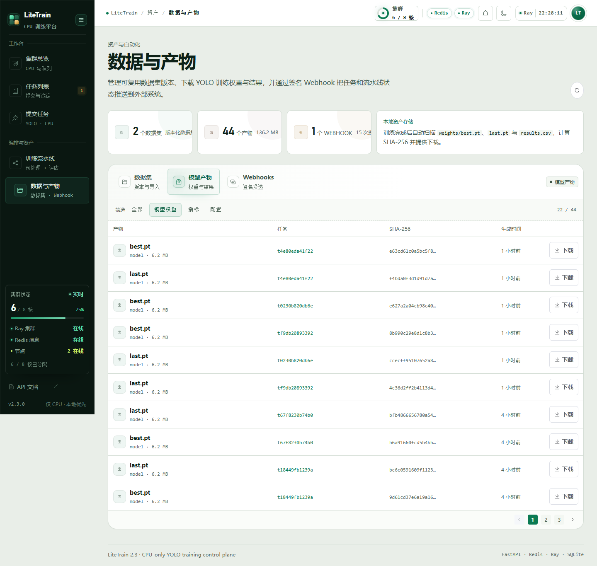

### 模型权重导入

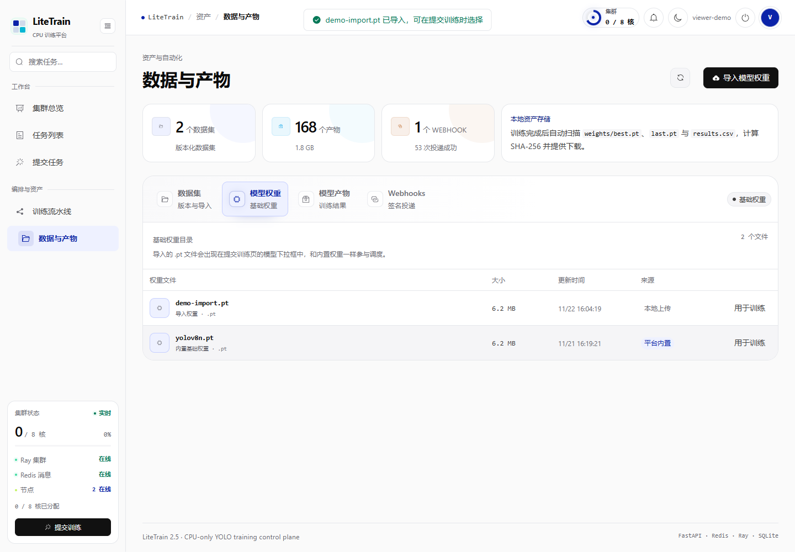

### 流水线 v2：可审计的预处理与评估

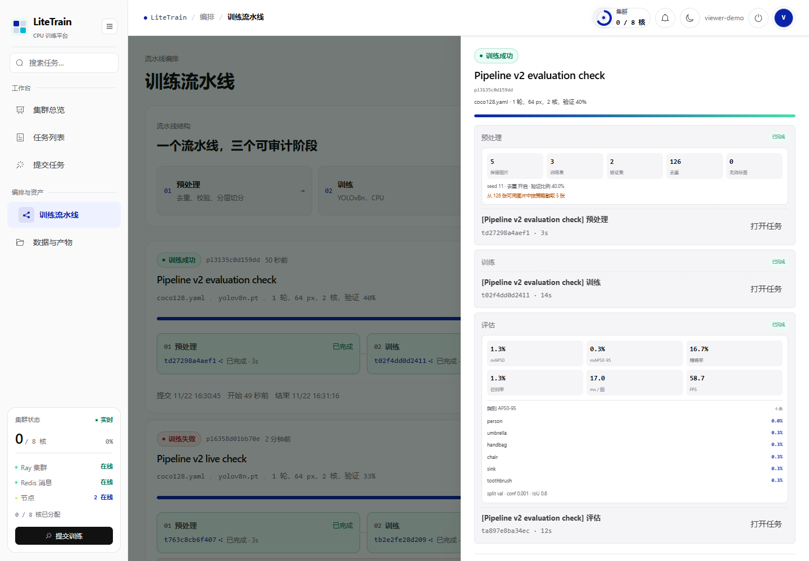

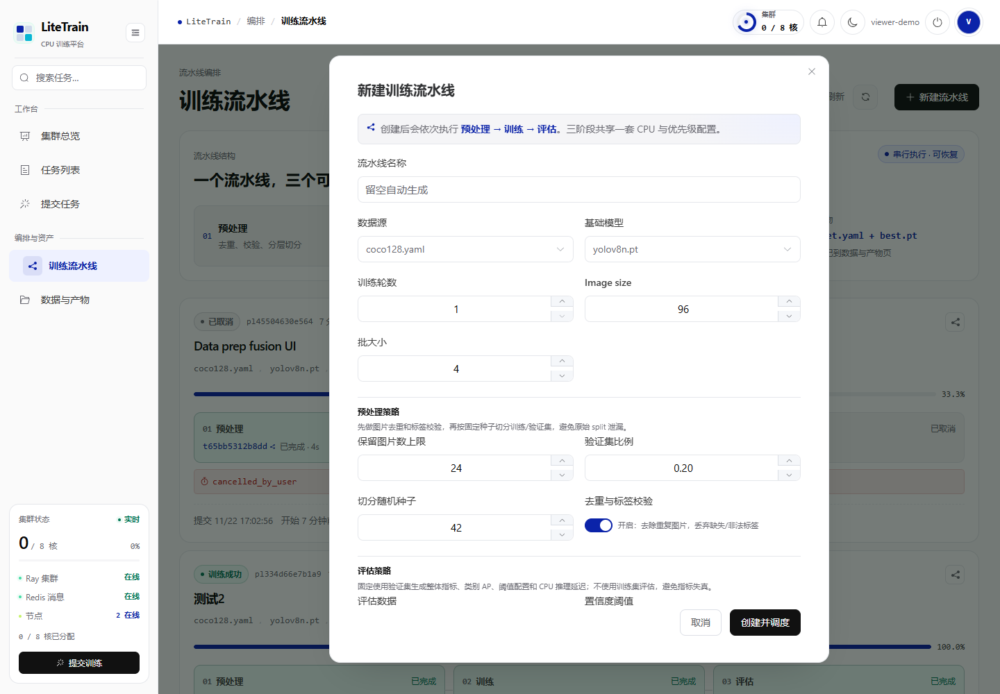

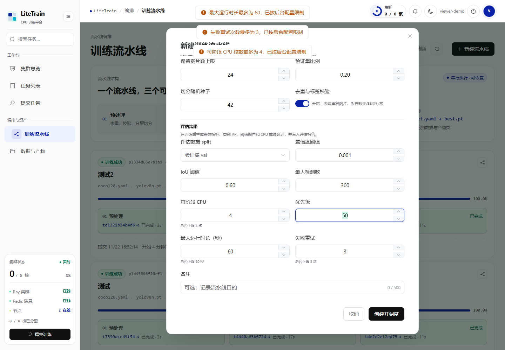

预处理任务详情：

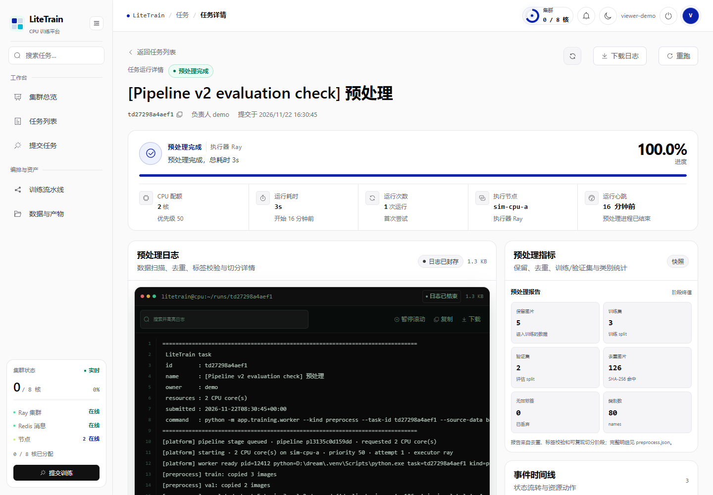

评估任务详情：

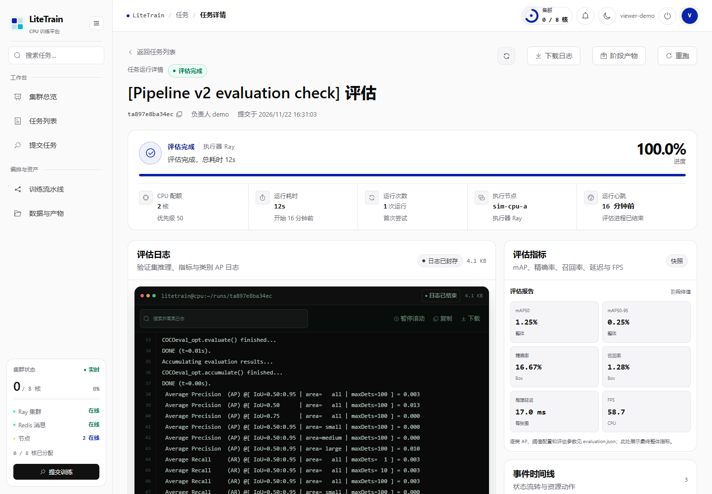

### 多节点拓扑模拟

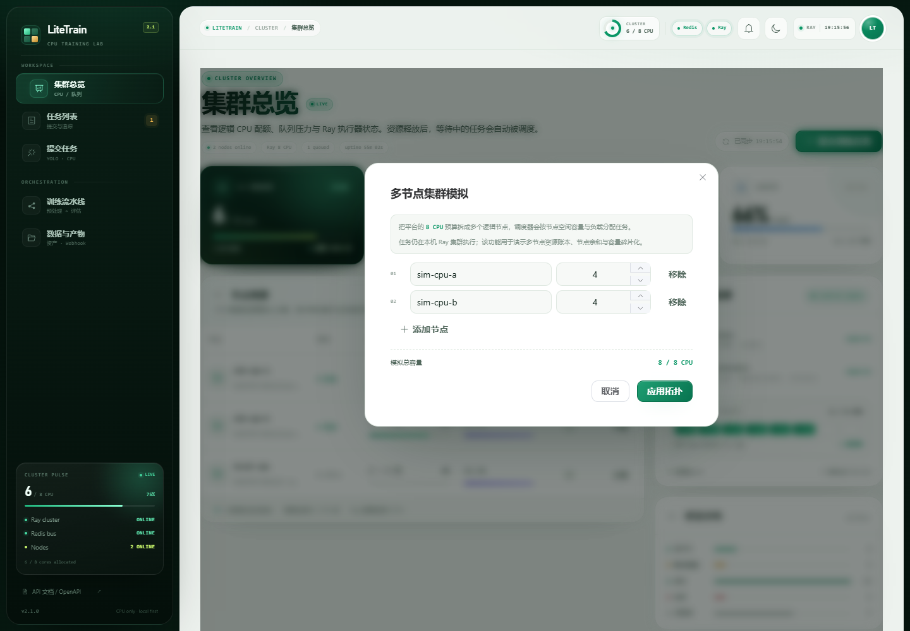

### Webhook 与投递记录

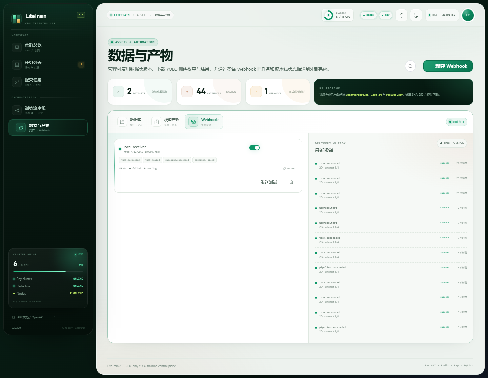

更多截图：登录 [login.png](docs/screenshots/login.png)、后台管理 [admin.png](docs/screenshots/admin.png)、任务列表 [tasks.png](docs/screenshots/tasks.png)、提交表单 [submit.png](docs/screenshots/submit.png)、数据准备融合 [task-data-preparation.png](docs/screenshots/task-data-preparation.png)、模型权重导入 [model-import.png](docs/screenshots/model-import.png)、超限提醒 [task-limits.png](docs/screenshots/task-limits.png)、流水线阶段报告 [pipeline-v2.png](docs/screenshots/pipeline-v2.png)、流水线配置 [pipeline-create-v2.png](docs/screenshots/pipeline-create-v2.png)、流水线超限 [pipeline-limits.png](docs/screenshots/pipeline-limits.png)、预处理详情 [preprocess-stage.png](docs/screenshots/preprocess-stage.png)、评估详情 [evaluate-stage.png](docs/screenshots/evaluate-stage.png)、排队详情 [queue.png](docs/screenshots/queue.png)、深色模式 [dark.png](docs/screenshots/dark.png)、收起导航 [sidebar-collapsed.png](docs/screenshots/sidebar-collapsed.png)、质量报告 [quality-report.png](docs/screenshots/quality-report.png)、运行设置 [settings.png](docs/screenshots/settings.png)、被抢占任务 [preemption.png](docs/screenshots/preemption.png)、原任务重跑历史 [rerun-inplace.png](docs/screenshots/rerun-inplace.png)、CPU Benchmark [benchmark.png](docs/screenshots/benchmark.png)、实验对比 [compare.png](docs/screenshots/compare.png)、状态分布 [distribution.png](docs/screenshots/distribution.png)、重跑 [rerun.png](docs/screenshots/rerun.png)。

> 截图由本机真实运行中的 `npm run dev` + FastAPI + Ray 页面生成，使用 Playwright 驱动 Edge，1440×1000 视口。当前界面为 **v2.5 Ultralytics-style workspace**：白色侧栏与任务搜索、蓝色品牌、细边框浅色卡片、黑色主按钮、浅色集群拓扑、数据质量准入和运行清单；字号、对比度、焦点和 reduced-motion 均按 `deepseek-frontend-design` 技能自检。说明见 [docs/screenshots/README.md](docs/screenshots/README.md)。

---

## 架构

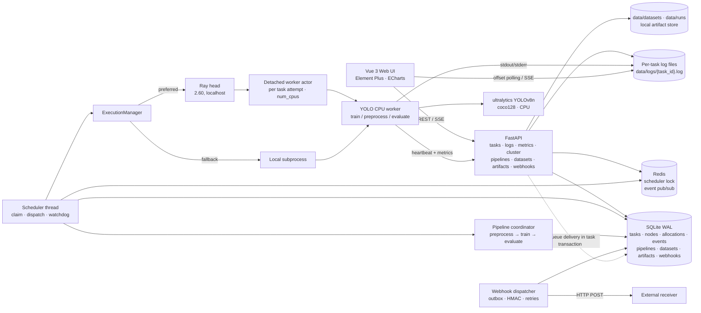

### 为什么是 Ray Core detached actor，而不是只在 API 进程内跑训练？

- Ray 负责 worker 的**进程隔离**和逻辑 CPU 预留（`num_cpus`）。
- actor 以 `lifetime="detached"`、确定性名字创建，API 重启后仍可 `ray.get_actor()` 找到它。
- 平台自己维护 SQLite 的 CPU 配额账本，不依赖 Ray 的内部状态展示队列；两边 CPU 预算保持一致（本例都是 8）。
- 没有把调度逻辑交给外部成品平台页面，也没有嵌入任何第三方训练平台 UI。

### 关键文件

| 路径 | 作用 |
| --- | --- |
| `backend/app/services/scheduler.py` | 调度、超时/心跳 watchdog、状态机、取消、重启恢复、流水线协调入口 |
| `backend/app/services/resources.py` | CPU 账本、多节点拓扑、用户配额、集群快照 |
| `backend/app/services/pipelines.py` | 三阶段流水线创建、推进、取消、产物衔接 |
| `backend/app/services/datasets.py` | 内置数据集注册、ZIP 导入、YAML 解析、统计 |
| `backend/app/services/models.py` | 基础模型权重扫描、上传校验与安全入库 |
| `backend/app/services/artifacts.py` | run 目录扫描、SHA-256、产物登记与安全下载 |
| `backend/app/services/webhooks.py` | endpoint CRUD、outbox 入队、HMAC 签名、重试 dispatcher |
| `backend/app/services/executors.py` | Ray detached actor / 本地子进程执行后端；按阶段生成命令 |
| `backend/app/training/worker.py` | train / preprocess / evaluate、心跳、资源采样、指标上报、原子 result |
| `backend/app/services/logs.py` | 独立日志文件、ANSI 清理、offset 增量读取 |
| `backend/app/services/tasks.py` | 任务 CRUD、队列位置、指标/事件查询 |
| `backend/app/api/tasks.py` | 任务 API + SSE |
| `backend/app/api/pipelines.py` | 流水线 API |
| `backend/app/api/assets.py` | 数据集/模型权重/产物 API |
| `backend/app/api/webhooks.py` | Webhook API |
| `backend/app/api/internal.py` | worker 心跳和指标内部接口 |
| `frontend/src/views/OverviewView.vue` | 集群总览、多节点拓扑对话框、节点上下线 |
| `frontend/src/views/TaskListView.vue` | 任务列表、筛选、分页、取消 |
| `frontend/src/views/TaskSubmitView.vue` | 任务表单与命令预览 |
| `frontend/src/views/TaskDetailView.vue` | 详情、终端、指标、事件 |
| `frontend/src/views/PipelinesView.vue` | 流水线列表、创建、阶段进度、详情抽屉 |
| `frontend/src/views/AssetsView.vue` | 数据集 / 模型权重 / 产物 / Webhooks |
| `frontend/src/components/LogTerminal.vue` | SSE + 增量轮询 + 虚拟滚动 + 高亮 |
| `frontend/src/components/MetricsPanel.vue` | YOLO/资源折线图 |

---

## 快速开始

> Windows 如果提示“无法加载文件，因为在此系统上禁止运行脚本”，先仅在当前终端放开执行策略：
>
> ```powershell
> Set-ExecutionPolicy -Scope Process -ExecutionPolicy Bypass
> ```

### 0. 环境要求

- **Python 3.11–3.13**（本文在 Python 3.13.5 验证）
- **Node.js ≥ 20.19**（本文在 Node 24.20、Vite 8 验证）
- **Redis ≥ 5**（本文在 Windows Redis 5.0.14 验证；低版本请保持 `LITETRAIN_REDIS_PROTOCOL=2`）
- **Ray 2.60**（Windows / Linux；`requirements.txt` 已指定 `ray[default]`）
- 仅 CPU。无需 GPU、CUDA、NCCL 或 DDP。

### 1. 安装依赖

Windows PowerShell：

```powershell
.\scripts\setup.ps1
```

或手动执行：

```powershell
python -m venv .venv
.\.venv\Scripts\python -m pip install --upgrade pip
.\.venv\Scripts\pip install torch torchvision --index-url https://download.pytorch.org/whl/cpu
.\.venv\Scripts\pip install -r backend\requirements-dev.txt
.\.venv\Scripts\python scripts\download_assets.py   # 仓库已带资产时是幂等的
cd frontend
npm install
```

> 仓库已包含 `backend/data/weights/yolov8n.pt` 和 `backend/data/datasets/coco128`，正常情况下不需要联网下载。`download_assets.py` 使用 GitHub / ghproxy / hf-mirror 多镜像，方便重新准备资产。

### 2. 启动 Redis

如果本机已安装 Redis：

```powershell
Get-Service redis
# 未运行时：Start-Service redis
```

或用 Docker：

```bash
docker run --rm -p 6379:6379 redis:7-alpine
```

Redis 只用于调度锁和事件广播；即使 Redis 不可用，平台也能运行，只是集群页会显示降级。

### 3. 启动 Ray（推荐）

```powershell
.\scripts\start_ray.ps1
```

它等价于：

```powershell
$env:RAY_ENABLE_UV_RUN_RUNTIME_ENV = "0"
$env:RAY_AUTH_MODE = "disabled"
$env:PYTHONPATH = "D:\path\to\repo\backend"
ray start --head --num-cpus=8 --port=6380 `
  --dashboard-host=127.0.0.1 --dashboard-port=8265 --disable-usage-stats
```

- Ray GCS 使用 **6380**，避免和 Redis 默认的 6379 冲突。
- Dashboard/Jobs API 使用 **8265**。
- `LITETRAIN_TOTAL_CPUS` 应与启动 Ray 时的 `--num-cpus` 一致（默认都是 8）。
- 停止：`.\scripts\start_ray.ps1 -StopRay`。
- Windows 上 Ray 2.60 需要设置 `RAY_ENABLE_UV_RUN_RUNTIME_ENV=0`；脚本已经处理。若手工启动遇到 `psutil.NoSuchProcess`/`is_repeated` 相关问题，请确认使用的是仓库环境里的 ray 2.60，并执行过 `pip install "ray[default]==2.60.0"`。

不启动 Ray 也可以：`LITETRAIN_EXECUTION_MODE=local` 时使用本地子进程。**但默认 `auto` 会优先 Ray**。

### 4. 启动后端

```powershell
.\scripts\start_backend.ps1
```

- API：<http://127.0.0.1:8000>
- Swagger：<http://127.0.0.1:8000/docs>
- 健康检查：<http://127.0.0.1:8000/healthz>
- 首次启动会自动建表、注册内置 COCO128 数据集并创建默认节点。

### 5. 启动前端（开发模式）

```powershell
.\scripts\start_frontend.ps1

# 另开一个终端启动后台管理
.\scripts\start_admin.ps1
```

- 训练平台：<http://127.0.0.1:5173>
- 后台管理：<http://127.0.0.1:5174>
- 两个端口使用独立 localStorage 和独立后端 session，互不影响登录
- Vite 把 `/api`、`/docs`、`/openapi.json`、`/healthz` 代理到 `127.0.0.1:8000`。

### 6. 生产构建（可选）

```powershell
cd frontend
npm run build
npm run build:admin
# 重启后端
.\scripts\start_backend.ps1
# 后台静态预览
npm run preview:admin
```

- 平台构建输出 `frontend/dist`，可由 FastAPI 托管。
- 后台构建输出 `frontend/dist-admin`，在独立端口 `5174` 预览。

### 7. Linux / macOS 手动启动

Windows 脚本本质上也是以下命令；在 Linux/macOS 上可以分别打开多个终端执行：

```bash
# 准备（仓库根目录）
python3 -m venv .venv
source .venv/bin/activate
pip install torch torchvision --index-url https://download.pytorch.org/whl/cpu
pip install -r backend/requirements-dev.txt
python scripts/download_assets.py

# Redis
redis-server --daemonize yes

# Ray 终端
source .venv/bin/activate
export RAY_ENABLE_UV_RUN_RUNTIME_ENV=0
export RAY_AUTH_MODE=disabled
export PYTHONPATH="$PWD/backend"
ray start --head --num-cpus=8 --port=6380 \
  --dashboard-host=127.0.0.1 --dashboard-port=8265 --disable-usage-stats

# FastAPI 终端
source .venv/bin/activate
PYTHONPATH=backend uvicorn app.main:app --host 127.0.0.1 --port 8000

# Vue 终端
cd frontend
npm install
npm run dev

# 后台管理终端
npm run dev:admin
```

### 8. 登录与后台管理

平台和后台使用不同端口、不同浏览器 origin，登录 session 独立：

```text
平台：http://127.0.0.1:5173
后台：http://127.0.0.1:5174
首次运行管理员：admin / admin123
```

- 管理员：可进入平台和后台，创建账号、分配角色、启停账号、重置密码、修改运行设置
- 操作员：可提交、取消、抢占相关操作和管理资产
- 只读成员：只能查看训练、日志和产物
- 后台「运行设置」是唯一可修改任务超时上限、心跳阈值、失败重试上限、默认 CPU 和单用户配额的入口；任务提交页和流水线创建页都不能超过超时/重试/CPU 上限。
- 生产部署请通过 `LITETRAIN_BOOTSTRAP_ADMIN_PASSWORD` 覆盖默认密码

### 9. 第一次任务

1. 登录后打开 `提交训练任务`。
2. 保留默认 3 epochs / 160px，或手动调整训练参数。
3. 点击 **提交 YOLO 训练任务**。
4. 在任务详情页观察日志与指标；约 20–60 秒可看到 `succeeded`。
5. 回到总览可看到 CPU 分配从 0 恢复为 0，资源已释放。

### 10. 演示 P2

**多节点模拟**：总览页 → 节点资源 → “多节点模拟”，输入 2 个节点各 4 CPU，应用后提交两个 3 CPU 任务，可看到两个节点各占 3/4。

**流水线**：侧边栏 → “训练流水线” → 新建流水线，选择 `coco128.yaml` 或上传的数据集，阶段会依次执行并自动登记 `best.pt`。

**数据集上传**：侧边栏 → “数据与产物” → “导入数据集”，上传包含 YOLO `dataset.yaml`、images、labels 的 zip。

**模型权重导入**：侧边栏 → “数据与产物” → “模型权重” → “导入模型权重”，上传 `.pt` checkpoint；导入成功后可直接点“用于训练”，提交页会自动选中该权重。

**Webhook**：

```powershell
# 终端 1：本地接收器（不需要额外依赖）
.\.venv\Scripts\python scripts\webhook_receiver.py --port 9099

# UI：数据与产物 → Webhooks → 新建 Webhook
# URL 填 http://127.0.0.1:9099/hook，事件选 task.succeeded / pipeline.succeeded
```

接收器会打印 `X-LiteTrain-Event / Delivery / Signature / Timestamp` 和 JSON body。

---

## 任务生命周期

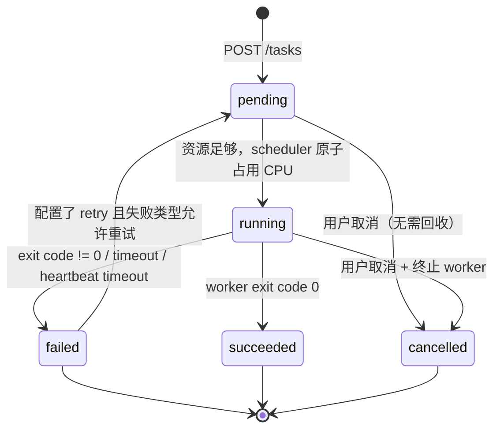

### 一次正常执行的内部顺序

1. `POST /tasks` 写入 SQLite，状态 `pending`，创建 `data/logs/{id}.log` 和 `data/runs/{id}/result.json` 路径。
2. Scheduler 每 1s 拿 Redis 短锁；按 `priority DESC, submitted_at ASC` 扫描 pending。
3. 资源足够时选择 online 节点，创建 `ResourceAllocation(active)`，状态原子更新为 `running`。
4. `ExecutionManager` 创建 Ray detached actor（`num_cpus = task.cpu_cores`），actor 启动 `python -m app.training.worker` 子进程。
5. Worker：
   - 启动心跳线程（每 4s）；
   - 上报进程 CPU/内存/epoch 进度；
   - 训练过程中通过 `on_fit_epoch_end` 调用指标接口；
   - 退出时原子写 `result.json`，再由 worker 的 `os._exit` 保证退出码。
6. Scheduler 观察到 `result.json`：exit 0 → `succeeded`，非 0 → `failed`。
7. 释放 allocation，清理 actor；如有下一次排队任务，下一 tick 自动调度。

### 流水线中的任务

每个流水线阶段仍然走上面同一套 Task 生命周期。区别是：

- 阶段 Task 由 coordinator 在资源调度前创建；
- 阶段 Task 成功后，coordinator 创建下一阶段 Task；
- 阶段失败/取消时，pipeline 终止，后续阶段标记 `cancelled`；
- 所有阶段共享同一条日志、心跳、指标和资源回收路径。

### 取消

- pending：直接标 cancelled，无 allocation。
- running：`ExecutionManager.stop` 终止 worker 进程树（Ray actor 的 `stop` + PID 兜底）→ 释放 allocation → 标 cancelled。
- 流水线取消：先取消当前阶段 Task，再把 pipeline 和未执行阶段标记 `cancelled`。

### 超时与僵死

- 任务超时：`now - started_at > max_runtime_seconds` → 终止 + `failed / runtime_timeout`。
- Worker 僵死：`now - last_heartbeat_at > 25s` → 终止 + `failed / heartbeat_timeout`。
- Worker 进程消失且没有 result：`failed / worker_exited_without_result`。
- 所有路径最终都会调用 `release_allocation`，资源看板立即回落。

### 重试

- 任务创建时可配置 `max_retries`（0–5）。
- 失败后若可重试：
  - `retry_count += 1`，状态回到 `pending`；
  - 删除旧的 `result.json`，避免新 attempt 误读上次结果；
  - 清理旧 epoch metrics；
  - 保留原日志，追加 attempt 分隔线和 `retrying` 信息；
  - 下一次调度重新分配 CPU。
- 超时、心跳超时和手动取消不重试，避免死循环。

### 优先级抢占

优先级调度和抢占是两层能力：

- **排队阶段**：所有 pending 任务按 `priority DESC, submitted_at ASC` 排序。
- **运行阶段**：高优先级任务无法获得资源时，调度器可以抢占同一节点上优先级至少低 20 分的 running 任务。
- 只抢占满足以下条件的任务：
  - 不是流水线阶段任务；
  - 当前 attempt 有可读取的 checkpoint 文件；
  - `preempt_count < 2`。
- 抢占不会新增第六种状态，也不会把任务伪装成“暂停”：
  1. 终止低优先级 worker；
  2. 释放原 allocation；
  3. 原任务标为 `cancelled`，`failure_reason=preempted`，记录 `preempted_by_task_id`；
  4. 原任务日志追加 `[platform] PREEMPTED by task ...`，事件写入 `preempted`；
  5. 用已有 `TaskService.resume` 从最近 checkpoint 创建新的 pending 子任务，子任务保留低优先级和 `resume_from_task_id`；
  6. 高优先级任务在下一个 scheduler tick 获得释放出来的 CPU。
- **不抢占没有 checkpoint 的任务**：当前 checkpoint 是 epoch 级别，抢占会丢失当前 epoch；等待比静默丢进度更安全。
- 抢占不改变原任务的日志文件；子任务使用自己的新日志，并追加 `preempted resume` 标记。

实测：

```text
低优先级 A 4 CPU running，checkpoint epoch 1
低优先级 B 4 CPU running，checkpoint epoch 1
高优先级任务 4 CPU pending
→ A cancelled / preempted，allocation 释放
→ resume 子任务 pending，priority 10，resume_from_task_id=A
→ 高优先级任务 running
```

### 重启恢复

- 所有任务状态、分配、节点、事件、指标都在 SQLite。
- API 重启时 `Scheduler.recover()`：
  - 有 `result.json` 的运行任务直接结算；
  - PID/actor 尚在的运行任务重新附着，并刷新心跳窗口；
  - 找不到 worker 的运行任务标记失败并按规则重试；
  - 为非 running 任务清理孤儿 allocation；
  - 流水线 coordinator 在下一个 tick 继续推进未完成阶段。
- **已实测**：运行任务的 4 CPU allocation 在 API 重启后仍然存在，worker 继续训练并成功完成。

---

## 核心设计

### 资源账本

- 调度只承认两种资源事实：节点总 CPU 和 active allocation 之和。
- 调度时同时检查：
  - 某节点 `node.total - SUM(active.cpus)` 是否满足；
  - `user_quota - SUM(active.cpus for owner)` 是否满足。
- 任务申请 CPU 必须能落在**单个 online 节点**上；超过最大节点容量时提交阶段直接 422。
- 多节点拓扑变更在无 active allocation 时进行，且节点总容量不得超过 `LITETRAIN_TOTAL_CPUS`。
- 使用 SQLite 事务 + `running` 状态检查防止同一任务双启动；Redis 短锁避免多 API 实例同时调度。

### 多节点模拟

- `Node` 表持久化逻辑节点；节点有 `online/offline`、总 CPU、最近心跳和主机名。
- 拓扑替换会保留历史分配记录，旧节点被标记 offline；无历史分配的旧节点直接删除。
- Scheduler 的 `choose_node` 在 online 节点中选择满足容量、用户配额且当前利用率最低的节点。
- 任务仍由本机 Ray head 执行；模拟的是**控制面资源账本和多节点调度决策**，不是跨物理机的 Ray worker。
- 节点下线前检查 active allocation；带任务节点禁止直接下线。重新上线也检查全局 CPU 预算，避免超过 Ray 实际 capacity。

### 日志

- 每个任务独立日志：`backend/data/logs/{task_id}.log`。
- `GET /tasks/{id}/logs?offset=&limit=` 返回：
  - `content`：清理 ANSI、`\r` 规整后的文本；
  - `start_offset` / `next_offset` / `file_size` / `eof`。
- 前端初始只拉取 128KB，之后通过 SSE 增量接收；SSE 断开自动退回 offset 轮询。
- 终端虚拟化：只渲染视口内行，固定行高 22px，最多保留 25,000 行。

### 指标

- 训练指标接口：`POST /api/v1/internal/tasks/{id}/metrics`（worker token header）。
- 指标来自 Ultralytics 回调，包含：
  - `train/box_loss`, `train/cls_loss`, `train/dfl_loss`
  - `val/box_loss`, `val/cls_loss`, `val/dfl_loss`
  - `metrics/mAP50(B)`, `metrics/mAP50-95(B)`, `metrics/precision(B)`, `metrics/recall(B)`
  - `lr/pg0` 等
- 前端按 epoch 绘制 loss、mAP/precision/recall、CPU 资源曲线。
- 评估阶段同样复用指标接口，`evaluate` Task 的最终指标可在任务详情/产物中查看。

### Ray 与本地降级

- `LITETRAIN_EXECUTION_MODE=auto`：先检查 Ray GCS 端口并 `ray.init(address=...)`；失败则使用本地子进程。
- 成功时在顶部/总览中显示 `RAY`；降级时显示 `LOCAL`。
- 两种执行器使用同一个 `app.training.worker`，因此日志、心跳、指标、重试逻辑完全一致。

### 为什么用 SQLite 而不是 Postgres？

- 作业要求明确列出 SQLite；本项目是单机演示，SQLite + WAL 足以支撑每秒级调度。
- 所有写入都使用短事务；查询/列表走索引。多 API 实例的调度互斥由 Redis 提供，但 SQLite 仍是单机数据库，不是分布式数据库。
- 若部署真实多机、多 API 副本，应将元数据迁移到 Postgres/MySQL；见 [docs/p2-design.md](docs/p2-design.md) 的演进部分。

---

## P2 高阶能力实现

完整设计与实现说明见 [docs/p2-design.md](docs/p2-design.md)。这里给出关键行为。

### 1. 多节点集群模拟

- 数据模型：`nodes` 表和 `resource_allocations.node_id` 已有；新增拓扑 API 与 UI。
- 预算：所有 online 节点总 CPU ≤ `LITETRAIN_TOTAL_CPUS`；单任务 CPU 必须能放入一个节点。
- 调度：选择满足容量的节点中当前利用率最低的，避免连续压满第一个节点。
- 状态：节点可下线/上线；有 active allocation 的节点不能下线；上线可能导致预算超限时拒绝。
- 验收：两个 4 CPU 节点上同时运行两个 3 CPU 任务，分别占用 3/4，合计 6/8。

### 2. 预处理 → 训练 → 评估流水线

- `pipelines` + `pipeline_stages` 保存状态；`PipelineStage.task_id` 关联普通 Task，**未修改 Task 既有 schema**。
- 创建 pipeline 时只创建 preprocess Task；后续阶段由 scheduler tick 中的 coordinator 创建。
- 阶段行为：
  - `preprocess`：扫描 train/val，SHA-256 去重、校验标签与坐标，按固定种子重新切分 train/val，生成安全 `dataset.yaml` 和 `preprocess.json`。
  - `train`：现有 YOLO worker，使用生成的数据集。
  - `evaluate`：用上一阶段 `runs/{task_id}/weights/best.pt` 执行 `YOLO.val()`，结果写回指标。
- 失败/取消：当前阶段失败或取消后，pipeline 终止，后续阶段 `cancelled`；支持通过 `POST /pipelines/{id}/cancel` 取消。
- API 重启：阶段 Task 和 pipeline 状态都在 DB，coordinator 在下一 tick 继续。
- 验收：真实 Ray 三阶段执行成功；`best.pt` 约 6.2 MB，下载 HTTP 200；`pipeline.succeeded` webhook 实际投递 204。

### 3. 数据集与产物

- `datasets`：内置 COCO128 自动登记；ZIP 上传后安全解压、校验 YAML、统计图片/标签/类别、复制原始归档。
- 上传后的 YAML 会被规范化：`path` 为绝对目录，文件名带 registry id，避免多个数据集同名冲突。
- 数据集只做软删除；历史任务和产物保留。
- `artifacts`：扫描每个 run 的 `weights/*.pt`、`results.csv`、`args.yaml`；计算 SHA-256 和大小，支持按 task/pipeline 查询。
- 下载前校验路径位于 `runs` 目录内，避免路径穿越。
- 验收：产物页列出 best/last/results/args；best.pt 下载 6,484,970 bytes。

### 4. 状态 Webhook

- 事件入队与 TaskEvent 在同一 SQLite 事务中完成（transactional outbox）。
- 事件名：`task.submitted / task.running / task.succeeded / task.failed / task.cancelled / task.retry_scheduled / pipeline.created / pipeline.running / pipeline.succeeded / pipeline.failed / pipeline.cancelled / webhook.test`。
- 投递头：
  - `X-LiteTrain-Event`
  - `X-LiteTrain-Delivery`（幂等键）
  - `X-LiteTrain-Timestamp`
  - `X-LiteTrain-Signature = HMAC-SHA256(secret, timestamp + "." + rawBody)`
- 2xx 成功；非 2xx/超时按指数退避重试，`LITETRAIN_WEBHOOK_MAX_ATTEMPTS` 后标记 failed。
- UI 可启用/禁用、发送测试、查看 endpoint 成功/失败/待投递数量和最近投递记录。
- 验收：本地接收器收到 4 条 pipeline / task 成功事件，均返回 204，outbox 全部成功。

---

## HTTP 接口

Base：`http://127.0.0.1:8000/api/v1`；完整 OpenAPI 在 `/docs`。

除登录和 worker 内部回调外，所有 API 都需要 `Authorization: Bearer <token>`。

### 登录与后台

| 方法 | 路径 | 说明 |
| --- | --- | --- |
| `POST` | `/auth/login` | 账号密码登录，返回 token 和权限 |
| `GET` | `/auth/me` | 当前账号和权限 |
| `POST` | `/auth/logout` | 注销当前 session |
| `GET` | `/admin/users` | 管理员查看平台账号 |
| `POST` | `/admin/users` | 管理员创建账号（admin/operator/viewer） |
| `PATCH` | `/admin/users/{id}` | 修改角色、启停、重置密码 |
| `GET/PATCH` | `/settings` | 仅管理员；运行策略 |

### 任务

| 方法 | 路径 | 说明 |
| --- | --- | --- |
| `POST` | `/tasks` | 提交任务，返回 201 + task |
| `GET` | `/tasks` | 分页列表，支持 `page`, `page_size`, `status`, `q`, `sort_by`, `sort_order` |
| `GET` | `/tasks/options` | 模型/数据集选项、CPU 与配额上限、默认表单值 |
| `POST` | `/tasks/preview` | 生成 worker 命令与等效 YOLO CLI |
| `GET` | `/tasks/{id}` | 任务详情（含 queue_position、运行时长、资源最新值） |
| `POST` | `/tasks/{id}/cancel` | 取消任务（排队或运行） |
| `GET` | `/tasks/{id}/logs` | `offset` 增量日志；`limit≤1MB` |
| `GET` | `/tasks/{id}/logs/stream` | SSE 实时日志，支持 `offset` |
| `GET` | `/tasks/{id}/logs/download` | 下载完整日志 |
| `GET` | `/tasks/{id}/events` | 事件时间线 |
| `GET` | `/tasks/{id}/metrics` | YOLO series + 资源采样 + final metrics |
| `GET` | `/tasks/{id}/manifest` | Run Manifest（数据/模型哈希、环境、Git） |
| `GET` | `/tasks/{id}/checkpoints` | Checkpoint 列表与 `fallback_available` |
| `POST` | `/tasks/{id}/resume` | 从指定 checkpoint 继续（`mode=full/weights`） |
| `POST` | `/tasks/{id}/rerun` | 在原任务上重跑：attempt+1、历史保留、不新建任务 |
| `GET` | `/tasks/{id}/attempts` | 原任务的手动重跑/自动重试运行历史 |
| `GET` | `/tasks/compare?ids=a,b` | 2–4 个任务对比 |

### 集群与多节点

| 方法 | 路径 | 说明 |
| --- | --- | --- |
| `GET` | `/cluster/overview` | CPU/内存/队列/节点/配额/Ray/Redis |
| `GET` | `/cluster/nodes` | 所有节点（含 offline） |
| `POST` | `/cluster/nodes/topology` | 替换为模拟节点拓扑；`nodes: [{name,total_cpus}]` |
| `PATCH` | `/cluster/nodes/{id}` | `online / offline`；带 active allocation 的节点不能下线 |
| `GET` | `/cluster/health` | 健康检查 |
| `GET` | `/cluster/task-distribution?window=1h` | 状态分布，支持 5m–180d / all |
| `POST` | `/cluster/benchmarks` | 启动 CPU 参数压测 |
| `GET` | `/cluster/benchmarks/latest` | 最近一次压测与推荐 profile |
| `GET` | `/version` | 版本、执行器、scheduler 后端信息 |

### 流水线

| 方法 | 路径 | 说明 |
| --- | --- | --- |
| `POST` | `/pipelines` | 创建流水线并创建第一阶段 Task |
| `GET` | `/pipelines` | 分页列表 |
| `GET` | `/pipelines/{id}` | 阶段、任务、进度、产物 |
| `POST` | `/pipelines/{id}/resume` | 从最近成功阶段继续失败/取消的流水线 |
| `POST` | `/pipelines/{id}/cancel` | 取消当前阶段及后续阶段 |

### 数据集与产物

| 方法 | 路径 | 说明 |
| --- | --- | --- |
| `GET` | `/datasets` | 数据集注册表 |
| `POST` | `/datasets/upload` | `multipart/form-data`：file/name/version/description |
| `GET` | `/datasets/{id}` | 数据集详情 |
| `GET` | `/datasets/{id}/download` | 下载原始 ZIP（内置数据集无归档时 404） |
| `DELETE` | `/datasets/{id}` | 软删除 |
| `POST` | `/datasets/{id}/audit` | 重新体检数据集 |
| `GET` | `/datasets/{id}/quality` | 质量摘要、issue 列表、报告 URL |
| `POST` | `/datasets/{id}/quality/ack` | 确认警告，允许进入训练 |
| `GET` | `/datasets/{id}/quality/report` | 打开 HTML 质量报告 |
| `GET` | `/models` | 基础 `.pt` 权重列表 |
| `POST` | `/models/upload` | `multipart/form-data`：file；校验 `.pt` 文件头、重名和 512 MB 上限，返回 SHA-256 |
| `GET` | `/artifacts` | 支持 `task_id` / `pipeline_id` / `kind` 过滤 |
| `GET` | `/artifacts/{id}/download` | 下载权重/指标/配置 |

### Webhooks

| 方法 | 路径 | 说明 |
| --- | --- | --- |
| `POST` | `/webhooks` | 注册 endpoint（URL/secret/events/active） |
| `GET` | `/webhooks` | endpoint 列表 + 投递计数 |
| `PATCH` | `/webhooks/{id}` | 启用/禁用 |
| `DELETE` | `/webhooks/{id}` | 删除 endpoint 及投递记录 |
| `POST` | `/webhooks/{id}/test` | 入队一条 `webhook.test` |
| `GET` | `/webhooks/deliveries` | 最近投递，可按 `endpoint_id` 过滤 |

### 运行设置

仅管理员可访问；后台管理页面的「运行设置」也是唯一修改入口。

| 方法 | 路径 | 说明 |
| --- | --- | --- |
| `GET` | `/settings` | 当前运行策略、允许范围和最近更新时间 |
| `PATCH` | `/settings` | 更新任务超时上限、心跳阈值、失败重试上限、默认 CPU、单用户配额；写入 SQLite 并即时生效 |

### Worker 内部回调

这些接口要求 header `X-Worker-Token`；token 在任务创建时生成，不返回给前端。

| 方法 | 路径 | 说明 |
| --- | --- | --- |
| `POST` | `/internal/tasks/{id}/heartbeat` | 心跳 + CPU/内存采样 + 进度 |
| `POST` | `/internal/tasks/{id}/metrics` | epoch 指标批量入库（幂等） |
| `POST` | `/internal/tasks/{id}/checkpoints` | 登记 epoch checkpoint |

### curl 示例

```bash
# 先登录，后续请求带 Bearer token
TOKEN=$(curl -s http://127.0.0.1:8000/api/v1/auth/login \
  -H "Content-Type: application/json" \
  -d '{"username":"admin","password":"admin123"}' | python -c "import json,sys; print(json.load(sys.stdin)['token'])")

# 提交 1 epoch 的快速任务
curl -X POST http://127.0.0.1:8000/api/v1/tasks \
  -H "Content-Type: application/json" \
  -H "Authorization: Bearer $TOKEN" \
  -d '{
    "name": "coco128 smoke",
    "model": "yolov8n.pt",
    "dataset": "coco128.yaml",
    "epochs": 1,
    "imgsz": 96,
    "batch_size": 4,
    "workers": 0,
    "cpu_cores": 4,
    "priority": 50,
    "max_runtime_seconds": 300,
    "max_retries": 0
  }'

curl "http://127.0.0.1:8000/api/v1/tasks/<id>/logs?offset=0&limit=32768"
curl http://127.0.0.1:8000/api/v1/tasks/<id>/metrics

# 模拟两个 4 CPU 节点
curl -X POST http://127.0.0.1:8000/api/v1/cluster/nodes/topology \
  -H "Content-Type: application/json" \
  -d '{"nodes":[{"name":"sim-a","total_cpus":4},{"name":"sim-b","total_cpus":4}]}'

# 创建三阶段流水线
curl -X POST http://127.0.0.1:8000/api/v1/pipelines \
  -H "Content-Type: application/json" \
  -d '{
    "source_dataset":"coco128.yaml",
    "model":"yolov8n.pt",
    "epochs":1,
    "imgsz":64,
    "batch_size":2,
    "cpu_cores":3,
    "max_images":8
  }'
```

### 日志 offset 语义

- offset 以**原始日志文件的字节数**计。
- 返回的 `content` 做了 ANSI/回车清理，所以 `len(content)` 不等于 `next_offset - start_offset`；客户端必须使用 `next_offset` 续读。
- 这是有意的：文件 raw offset 稳定，展示层可安全清理控制字符。

---

## 配置项

配置文件：`backend/.env`（从 `backend/.env.example` 复制）；所有变量带 `LITETRAIN_` 前缀。

| 变量 | 默认 | 说明 |
| --- | --- | --- |
| `LITETRAIN_DATABASE_URL` | `sqlite:///backend/data/platform.db` | 元数据库 |
| `LITETRAIN_TOTAL_CPUS` | `8` | 平台逻辑 CPU 池 / 多节点总预算 |
| `LITETRAIN_USER_CPU_QUOTA` | `8` | 单用户并发 CPU 上限 |
| `LITETRAIN_EXECUTION_MODE` | `auto` | `auto / ray / local` |
| `LITETRAIN_RAY_GCS_ADDRESS` | `127.0.0.1:6380` | Ray head GCS |
| `LITETRAIN_RAY_NAMESPACE` | `litetrain` | detached actor namespace |
| `LITETRAIN_REDIS_URL` | `redis://127.0.0.1:6379/0` | Redis |
| `LITETRAIN_REDIS_PROTOCOL` | `2` | 兼容 Redis 5 |
| `LITETRAIN_AUTH_ENABLED` | `true` | 平台与后台登录开关 |
| `LITETRAIN_AUTH_SESSION_HOURS` | `12` | 登录 session 有效期 |
| `LITETRAIN_BOOTSTRAP_ADMIN_USERNAME` | `admin` | 首次启动管理员账号 |
| `LITETRAIN_BOOTSTRAP_ADMIN_PASSWORD` | `admin123` | 首次启动管理员密码，生产必须覆盖 |
| `LITETRAIN_HEARTBEAT_INTERVAL_SECONDS` | `4` | worker 心跳周期 |
| `LITETRAIN_HEARTBEAT_TIMEOUT_SECONDS` | `25` | 心跳超时阈值 |
| `LITETRAIN_DEFAULT_MAX_RUNTIME_SECONDS` | `1800` | 任务超时上限，同时是新任务默认值 |
| `LITETRAIN_WORKER_API_BASE` | `http://127.0.0.1:8000/api/v1` | worker 回调地址 |
| `LITETRAIN_WORKER_PYTHON` | 当前解释器 | 实际训练用的 venv Python |
| `LITETRAIN_PIPELINE_DEFAULT_MAX_IMAGES` | `24` | 流水线预处理默认图片上限 |
| `LITETRAIN_WEBHOOK_MAX_ATTEMPTS` | `4` | Webhook 最大投递次数 |
| `LITETRAIN_WEBHOOK_RETRY_BASE_SECONDS` | `2` | 首次退避基数，随后指数增长 |
| `LITETRAIN_WEBHOOK_TIMEOUT_SECONDS` | `5` | 单次 HTTP 超时 |
| `LITETRAIN_WEBHOOK_DISPATCHER_INTERVAL_SECONDS` | `1` | dispatcher 轮询周期 |
| `LITETRAIN_SERVE_FRONTEND` | `true` | dist 存在时由 FastAPI 托管 |
| `LITETRAIN_CORS_ORIGINS` | `http://localhost:5173,...` | 开发跨域白名单 |

完整默认值见 `backend/app/config.py`。

---

## 测试与验收

### GitHub Actions

仓库包含 [`.github/workflows/ci.yml`](.github/workflows/ci.yml)，在 push 到 `main`、Pull Request 和手动触发时运行：

- **Backend tests**：Python 3.13 + CPU PyTorch，安装依赖后执行 `pytest`
- **Frontend typecheck and build**：Node.js 22，执行 `npm ci`、`vue-tsc --noEmit`、`vite build` 和后台 `build:admin`

首次运行需要下载 PyTorch / Ray / Ultralytics，GitHub Actions 会自动缓存 pip 和 npm 依赖。

### 自动测试

```powershell
cd backend
..\.venv\Scripts\python -m pytest
```

结果：**53 passed**。测试覆盖 P0/P1 + P2：

- 创建、分页、状态筛选、ID/名称搜索；
- 表单选项和命令预览；
- 增量日志 offset 与 ANSI 清理；
- worker 心跳鉴权、指标幂等入库；
- 取消 pending / running 与 409 冲突；
- 超时失败与 allocation 回收；
- 心跳超时失败与回收；
- 正常退出成功；
- 非 0 退出自动重试、二次失败终态；
- 资源容量、用户配额与优先级队列位置；
- 非法 CPU/缺失资产 422、缺失任务 404；
- **多节点拓扑、节点上下线、双节点负载均衡**；
- **数据集 ZIP 导入、YAML 规范化、重复版本冲突、归档下载**；
- **产物扫描、SHA-256、下载**；
- **流水线三阶段自动推进、失败终止/取消、阶段产物衔接**；
- **Webhook 事务入队、HMAC 签名、2xx 成功、失败重试、测试投递**。

### 黑盒联调

先启动 Ray、Redis、后端，再执行：

```powershell
.\.venv\Scripts\python scripts\e2e_live.py
```

它会实际提交 3 个任务，验证队列、SSE、取消、超时和自动派发。

P2 端到端演示：

```powershell
.\.venv\Scripts\python scripts\e2e_p2.py
```

它会注册 webhook、创建真实的预处理→训练→评估流水线、轮询状态、检查产物下载，并打印投递结果。本机实测：

```text
pipeline: plb7d3e20732fd
status: pending → running → succeeded
preprocess succeeded · train succeeded · evaluate succeeded
artifacts: best.pt 6484970 · last.pt 6484970 · results.csv · args.yaml
download: 200 6484970 bytes
webhook deliveries: pipeline.succeeded success 204, task.succeeded success 204 ×3
PIPELINE E2E OK
```

### 多节点实测

```text
topology: sim-cpu-a 4 CPU, sim-cpu-b 4 CPU
two 3-CPU tasks:
  sim-cpu-a allocated=3 running=1
  sim-cpu-b allocated=3 running=1
aggregate: allocated=6 / 8
third 3-CPU task: pending，排队位置 #1
```

### 重启恢复实测

运行一个 8 epoch 任务，在训练进行中杀掉 FastAPI 进程并重启：

```text
BEFORE_RESTART status=running progress=2.0 hb=...35.212Z
AFTER_RESTART  status=running progress=12.5 hb=...52.705Z allocated=4
LATER          status=succeeded runtime=91s
```

说明：Ray detached actor + SQLite allocation 持久化确实让训练继续，API 重新附着并继续心跳判定。

### 截图

最终截图位于 `docs/screenshots/`，使用 Playwright 驱动本机 Edge，对真实运行中的页面截图：

- P0：总览 / 列表 / 提交 / 详情 / 排队 / 深色模式；
- P2：流水线 / 数据集 / 产物 / Webhook / 多节点拓扑。

---

## 已知边界

- **抢占是 checkpoint 级恢复，不是进程挂起**：当前只在最近完整 checkpoint 上恢复，当前 epoch 会丢失；无 checkpoint 不抢占。
- **抢占只针对独立任务**：流水线阶段任务不参与抢占，避免破坏三阶段串行状态。
- **多节点是控制面模拟**：节点是逻辑资源池，任务仍由本机 Ray head 执行；不是真正的跨物理机 Ray worker 集群。
- **SQLite**：适合单机演示，不适合多 API 实例共享；真实多实例需迁移 Postgres 并加行级锁。
- **流水线固定三阶段**：题目指定 preprocess → train → evaluate；没有通用 DAG 编辑器、分支或并行阶段。
- **无鉴权/多租户**：题目是单用户演示；生产需要 OIDC/JWT、任务级权限和审计。
- **后台任务上限**：任务提交页的运行时长和失败重试次数受后台「运行设置」约束；超过时前端提示并回退，API 直接返回 422。
- **认证**：密码使用 PBKDF2-SHA256 哈希；session token 存在 SQLite，可注销；前端 token 存在 localStorage，生产建议改为纯 HttpOnly Cookie 并增加登录限流。
- **默认管理员密码**：首次启动为 `admin/admin123`；生产部署必须通过环境变量修改。
- **抢占粒度**：只在 checkpoint 边界恢复；无 checkpoint 不抢占，当前 epoch 的进度会回退到最近 checkpoint。抢占只针对独立任务，不处理流水线阶段。
- **数据集删除是软删除**：记录和原始归档保留；不做对象存储生命周期管理。
- **模型权重导入**：只校验扩展名、文件头、路径、重名和大小，不会在导入时执行或反序列化 `.pt`；生产可再加病毒扫描和模型结构校验。
- **流水线预处理**：只做文件内容的精确 SHA-256 去重，不做感知哈希；标签校验覆盖格式、类别范围、坐标范围，但不替代人工质检。
- **Webhook 未做生产级 SSRF 防护**：只校验 http(s)；生产应增加内网/回环地址拦截、secret 加密和 dead-letter 重放。
- **本地子进程模式**：没有 Ray 的进程隔离和逻辑资源预留；平台仍按账本限制。
- **Windows**：使用 Redis 5 时必须 `protocol=2`；训练进程需要 `KMP_DUPLICATE_LIB_OK=TRUE`（执行器自动设置）；Ray 启动由 `scripts/start_ray.ps1` 处理环境变量。
- **不嵌入第三方平台**：没有 Kubeflow/Cube Studio/Airflow 页面或 iframe。
- **CPU-only**：worker 强制 `device=cpu`，Ray actor 仅申请 CPU 资源。

---

## 第三方资产与许可

- 代码：MIT，见 [LICENSE](LICENSE)。
- `yolov8n.pt` 权重与 `coco128` 数据集来自 [Ultralytics assets](https://github.com/ultralytics/assets)，分别遵循其仓库/数据集许可；`backend/data/datasets/coco128/LICENSE` 是原始 COCO128 许可文件。
- 使用 ultralytics 时请遵守其 AGPL-3.0 许可要求。

---

## 仓库结构

```text
.
├─ backend/
│  ├─ app/
│  │  ├─ api/            # tasks, internal, cluster, pipelines, assets, webhooks
│  │  ├─ services/       # scheduler, resources, logs, executors, pipelines,
│  │  │                  # datasets, artifacts, webhooks, Ray actor
│  │  ├─ training/       # worker + command/asset resolution
│  │  ├─ config.py
│  │  ├─ database.py
│  │  ├─ models.py
│  │  ├─ schemas.py
│  │  └─ main.py
│  ├─ data/              # demo assets, logs, runs, SQLite
│  ├─ tests/             # P0/P1/P2 tests
│  ├─ requirements.txt
│  └─ pytest.ini
├─ frontend/
│  ├─ src/
│  │  ├─ views/          # overview, tasks, submit, detail, pipelines, assets
│  │  ├─ components/     # terminal, metrics, status
│  │  ├─ layout/
│  │  ├─ api/
│  │  └─ router/
│  ├─ vite.config.ts
│  └─ package.json
├─ scripts/              # setup / start / asset download / live e2e / P2 e2e / webhook receiver
├─ docs/
│  ├─ screenshots/       # P0 + P2 screenshots
│  └─ p2-design.md       # P2 implementation + production evolution
└─ README.md
```
