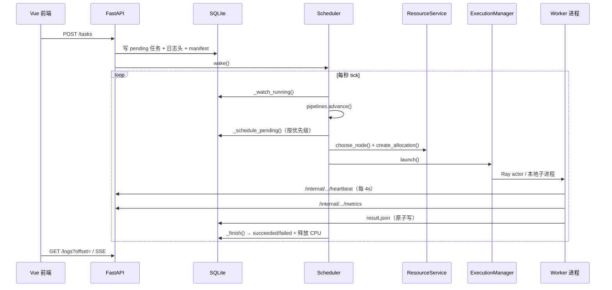
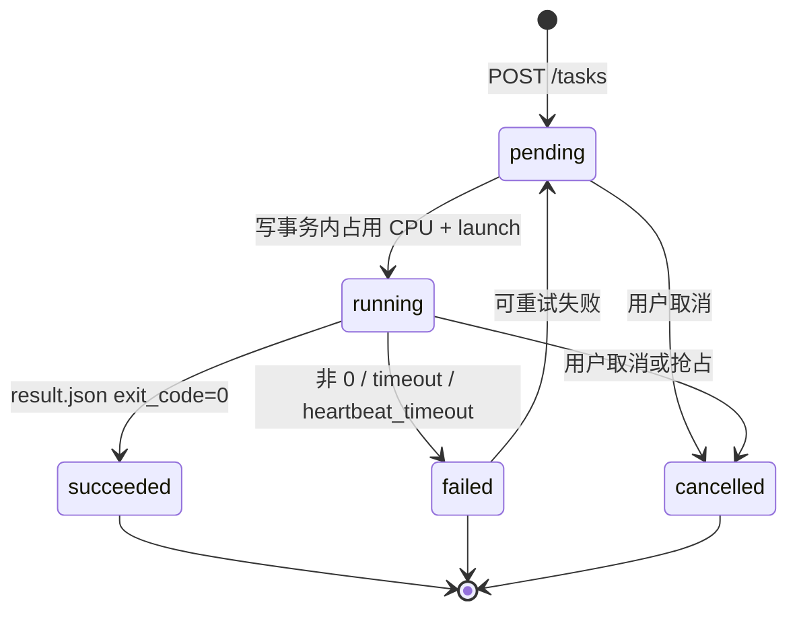

# LiteTrain 核心代码导读

| 项 | 内容 |
| --- | --- |
| 文档版本 | v1.0 |
| 日期 | 2026-11-22 |
| 面向读者 | 需要快速接手代码的开发 / 面试官 |
| 代码基线 | LiteTrain v2.5.0 |
| 引用格式 | `起始行:结束行:文件路径`，行号对应当前仓库代码 |
| 配套文档 | [需求规格](requirements-spec.md) · [技术设计](technical-design.md) · [TDD 测试规格](tdd-test-spec.md) |

> 本文只讲**重点功能是怎么写出来的**。完整架构与规格见配套文档；本文所有代码片段均来自真实源码，便于按图索骥。

---

## 1. 代码地图：先记住这 8 个文件

| 关注点 | 文件 | 一句话职责 |
| --- | --- | --- |
| 启动装配 | `backend/app/context.py` | 依赖组装根；建库、连 Redis/Ray、注册默认节点、重启恢复 |
| API 入口 | `backend/app/main.py` | FastAPI app、路由挂载、鉴权中间件、SPA 托管 |
| 任务 API | `backend/app/api/tasks.py` | 提交/列表/详情/取消/增量日志/SSE |
| 任务领域 | `backend/app/services/tasks.py` | 参数校验、质量准入、建任务、manifest、resume/rerun |
| **调度心脏** | `backend/app/services/scheduler.py` | tick、watchdog、派发、终态、重试、抢占、取消、恢复 |
| 资源账本 | `backend/app/services/resources.py` | CPU 分配/释放、节点选择、用户配额、拓扑 |
| 执行后端 | `backend/app/services/executors.py` | Ray detached actor / 本地子进程；启动、探测、终止 |
| 训练进程 | `backend/app/training/worker.py` | 心跳、指标、checkpoint、原子 `result.json` |

前端再记 3 个：`api/client.ts`（接口封装）、`router/index.ts`（权限路由）、`components/LogTerminal.vue`（日志终端）。

---

## 2. 整体调用链



---

## 3. 启动链路：服务起来时发生了什么

`create_app()` 用 lifespan 管理生命周期。注意 `ctx` 在 lifespan **之外**构建，`initialize()` 才是启动时的动作：

```74:94:backend/app/main.py
    ctx = AppContext.build(settings)

    @asynccontextmanager
    async def lifespan(app: FastAPI):  # noqa: ANN202
        logger.info("starting %s v%s", settings.app_name, __version__)
        ctx.initialize()
        if start_scheduler:
            ctx.scheduler.start()
            ctx.webhook_dispatcher.start()
        ...
        finally:
            ctx.shutdown()
```

`AppContext.build()` 把 14 个服务按依赖顺序装配好，并让 `PipelineService` 能唤醒 scheduler：

```54:82:backend/app/context.py
    @classmethod
    def build(cls, settings: Settings) -> AppContext:
        settings.ensure_directories()
        db = Database(settings.database_url)
        auth = AuthService(settings, db)
        log_store = LogStore(settings.logs_dir)
        broker = EventBroker(...)
        resources = ResourceService(settings, db)
        execution = ExecutionManager(settings, db)
        tasks = TaskService(settings, db, log_store, broker, datasets=datasets, quality=quality)
        ...
        scheduler = Scheduler(settings, db, log_store, broker, resources, execution, tasks, pipelines)
        pipelines.wake_callback = scheduler.wake
```

`initialize()` 的顺序体现了「先恢复数据，再启动调度」：

```103:114:backend/app/context.py
    def initialize(self) -> None:
        self.db.init()
        self.auth.ensure_bootstrap_admin()
        self.runtime_settings.load()
        self.broker.connect()
        self.execution.connect()
        self.resources.ensure_node()
        self.datasets.seed_builtin()
        self.quality.recover()
        self.benchmark.recover()
        self.scheduler.recover()
        self.scheduler.pipelines = self.pipelines
```

**注意**：`ensure_node()` 只在空库时创建默认节点，所以模拟拓扑能跨重启保留（`resources.py:58-81`）。

### 鉴权中间件

`main.py:136-162` 定义 `required_permission(method, path)`，把路径映射到 `platform.view / submit / operate / assets / admin.console`；`main.py:164-202` 的 `auth_guard` 跳过 `/auth/login`、`/internal/*` 和非 API 路径，支持 Bearer 与 `litetrain_session` cookie。

---

## 4. 重点功能一：任务提交

入口极薄，只调 `TaskService.create()` 并唤醒调度器：

```53:65:backend/app/api/tasks.py
@router.post(
    "",
    response_model=TaskOut,
    status_code=status.HTTP_201_CREATED,
    summary="Submit a YOLO CPU training task",
)
def create_task(payload: TaskCreate, ctx: AppContext = Depends(get_ctx)) -> TaskOut:
    try:
        task = ctx.tasks.create(payload)
    except TaskValidationError as exc:
        raise HTTPException(status_code=exc.status_code, detail=exc.message) from exc
    ctx.scheduler.wake()
    return task
```

`TaskService.create()` 做四件事：

1. **补齐运行策略默认值**：没传 `max_runtime_seconds` / `max_retries` 时取后台设置上限（`tasks.py:256-259`）。
2. **校验数据集与模型**：`_dataset_record()` + `_validate_request()`，数据集必须先登记且通过质量准入，否则 422。
3. **建 Task 行**：状态 `pending`，`device="cpu"`，生成 `worker_token`、`log_path`、`result_path`、`config_json` 快照。

```304:336:backend/app/services/tasks.py
        task = Task(
            id=task_id,
            name=name,
            owner="demo",
            status=TaskStatus.PENDING.value,
            ...
            device="cpu",
            cpu_cores=payload.cpu_cores,
            max_runtime_seconds=payload.max_runtime_seconds,
            max_retries=payload.max_retries,
            config_json=json.dumps(config, ensure_ascii=False),
            log_path=str(log_path),
            result_path=str(run_dir / "result.json"),
            worker_token=secrets.token_urlsafe(32),
        )
```

4. **写 manifest、事件、日志头**：

```339:362:backend/app/services/tasks.py
            self.manifests.persist(session, task, model_path=model_path, dataset=record)
            add_event(session, task.id, "submitted", ...)
            self.record_attempt(session, task)
        ...
        self.log_store.header(task_id, name=name, command=display_command, ...)
```

> `worker_token` 只入库存 DB，不返回前端；worker 靠环境变量拿到它回调控制面。

---

## 5. 重点功能二：调度循环（整个平台的心脏）

### 5.1 线程与主循环

```79:108:backend/app/services/scheduler.py
    def start(self) -> None:
        if self._thread and self._thread.is_alive():
            return
        self._stop_event.clear()
        self._thread = threading.Thread(target=self._loop, name="litetrain-scheduler", daemon=True)
        self._thread.start()
        ...

    def _loop(self) -> None:
        while not self._stop_event.is_set():
            started = time.monotonic()
            try:
                self.tick()
            except Exception as exc:
                self.last_error = f"{type(exc).__name__}: {exc}"
            remaining = self.settings.scheduler_interval_seconds - (time.monotonic() - started)
            self._wake_event.wait(max(0.05, remaining))
            self._wake_event.clear()
```

用 `_wake_event.wait()` 而不是 `sleep()`，让提交/取消/流水线能立刻唤醒下一 tick，不必等满 1 秒。

### 5.2 tick 的三段式

```182:191:backend/app/services/scheduler.py
    def tick(self) -> None:
        with self.broker.scheduler_lock(ttl_ms=self.settings.scheduler_lock_ttl_ms) as acquired:
            if not acquired:
                return
            with self._state_lock:
                self._watch_running()
                if self.pipelines is not None:
                    self.pipelines.advance()
                self._schedule_pending()
            self.last_tick_at = utcnow()
```

Redis 短锁（TTL 30s）保证多 API 实例不重复调度；Redis 不可用时 `EventBroker` 退化为进程内锁。

### 5.3 派发：优先级排序 + 原子占用 + 启动

```440:469:backend/app/services/scheduler.py
    def _schedule_pending(self) -> None:
        with self.db.session() as session:
            pending = session.scalars(
                select(Task)
                .where(Task.status == TaskStatus.PENDING.value)
                .order_by(Task.priority.desc(), Task.submitted_at.asc())
            ).all()
            candidate_ids = [task.id for task in pending]
        for task_id in candidate_ids:
            with self.db.session() as session:
                task = session.get(Task, task_id)
                node = self.resources.choose_node(session, task.owner, task.cpu_cores)
                if node is None:
                    blocked_high_id = task_id
                    break
                # Atomic claim inside this SQLite write transaction.
                task.status = TaskStatus.RUNNING.value
                task.started_at = utcnow()
                task.last_heartbeat_at = task.started_at
                ...
```

关键点：**在写事务里重新读状态 + 占用 CPU**，防止同一任务被两个 tick 双启动。先写 `executor/ray_actor_name`（`scheduler.py:476-488`），这样即使在启动窗口崩溃，重启后也能按名字找到 detached actor；然后再 `execution.launch()` 并回写 PID（`scheduler.py:498-522`）。

如果队首高优先级任务被卡住，tick 末尾会尝试抢占：

```524:526:backend/app/services/scheduler.py
        if blocked_high_id is not None:
            high = self.tasks.get_model(blocked_high_id)
            self._preempt_for(high)
```

### 5.4 Watchdog：四种终态判定

`_inspect_running()` 按固定优先级检查（`scheduler.py:203-268`）：

| 顺序 | 条件 | 结果 |
| --- | --- | --- |
| 1 | `result.json` 存在 | `exit_code=0` → `succeeded`；非 0 → `failed` |
| 2 | `now - started_at > min(task.max_runtime, admin_cap)` | `failed/runtime_timeout` |
| 3 | `now - (last_heartbeat_at or started_at) > 25s` | `failed/heartbeat_timeout` |
| 4 | PID 存在、启动超过 2s 但进程消失 | `failed/worker_exited_without_result` |

```225:253:backend/app/services/scheduler.py
            if task.started_at:
                running_for = (now - task.started_at).total_seconds()
                runtime_limit = min(task.max_runtime_seconds, self.settings.default_max_runtime_seconds)
                if running_for > runtime_limit:
                    self._terminate(task, TaskStatus.FAILED, "runtime_timeout", ..., session=session)
                    return
            heartbeat_reference = task.last_heartbeat_at or task.started_at
            if heartbeat_reference:
                stale_for = (now - heartbeat_reference).total_seconds()
                if stale_for > self.settings.heartbeat_timeout_seconds:
                    self._terminate(task, TaskStatus.FAILED, "heartbeat_timeout", ..., session=session)
                    return
```

超时取 `min(任务值, 管理员上限)`，所以后台运行设置能覆盖任务自身配置。

### 5.5 统一终态：`_finish()`

所有成功、失败、重试路径都收敛到这里（`scheduler.py:543-675`）：

1. `execution.cleanup(task)` 先清理执行器（重试会重置 actor 名/PID，必须趁元数据还在时清理）；
2. `resources.release_allocation()` 释放 CPU；
3. 判断是否重试：`FAILED` 且 `retry_count < max_retries` 且 `_retry_eligible()`；
4. 写状态、事件、日志、广播。

```664:675:backend/app/services/scheduler.py
    @staticmethod
    def _retry_eligible(reason: str | None) -> bool:
        if not reason:
            return True
        return reason not in {
            "runtime_timeout",
            "heartbeat_timeout",
            "cancelled_by_user",
        }
```

重试分支会删掉旧 `result.json` 和该任务的 `TaskMetric`，否则新 attempt 会因唯一约束 `(task_id, name, epoch, step)` 无法写入指标（`scheduler.py:587-606`）。

最后 `self.wake()` 立即唤醒调度，让释放出来的 CPU 马上派发给下一个排队任务。

---

## 6. 重点功能三：资源账本（为什么不会超卖）

唯一资源事实 = `nodes.total_cpus` 与 `resource_allocations(state='active')` 之和。

```140:163:backend/app/services/resources.py
    def choose_node(self, session: Session, owner: str, requested: int) -> Node | None:
        if requested <= 0:
            return None
        owner_used = self.owner_allocated_cpus(session, owner)
        if requested > max(0, self.settings.user_cpu_quota - owner_used):
            return None
        allocated = self.allocated_by_node(session)
        nodes = self.online_nodes(session)
        candidates = [
            node for node in nodes
            if requested <= max(0, node.total_cpus - allocated.get(node.id, 0))
        ]
        if not candidates:
            return None
        # Load-balance: prefer the node with the lowest current utilization.
        return min(candidates, key=lambda node: (...))
```

- 先查**单用户配额**，再查**节点空闲容量**；任务必须能放进单个节点，否则返回 `None`（提交阶段直接 422，而不是无限排队）。
- 多节点时选当前利用率最低的候选节点，避免总压在第一个节点上。
- 释放是「置 `released` 并写 `released_at`」，不物理删除，历史可追溯：

```168:179:backend/app/services/resources.py
    def release_allocation(self, session: Session, task_id: str) -> int:
        allocations = session.scalars(
            select(ResourceAllocation).where(
                ResourceAllocation.task_id == task_id,
                ResourceAllocation.state == AllocationState.ACTIVE.value,
            )
        ).all()
        now = utcnow()
        for allocation in allocations:
            allocation.state = AllocationState.RELEASED.value
            allocation.released_at = now
        return sum(item.cpus for item in allocations)
```

拓扑替换要求没有任何 active allocation，且节点总容量不超过 `LITETRAIN_TOTAL_CPUS`（`resources.py:195-242`）。

---

## 7. 重点功能四：执行层（Ray actor + 本地降级）

### 7.1 连接策略

```115:128:backend/app/services/executors.py
    def connect(self) -> None:
        if self.requested_mode == "local":
            self.backend = "local"
            return
        try:
            self._connect_ray()
            self.backend = "ray"
        except Exception as exc:
            self.backend = "local"
            self.connection_error = f"{type(exc).__name__}: {exc}"
```

`auto` 模式先探测 Ray GCS 端口再 `ray.init(address=...)`；失败就降级为本地子进程，UI 会显示 `LOCAL`。两种后端跑的是**同一个** `app.training.worker`，所以日志、心跳、指标路径完全一致。

### 7.2 为什么是 detached actor（而不是 `ray job submit`）

```350:367:backend/app/services/executors.py
        name = self.actor_name(task)
        self._kill_actor_by_name(name, missing_ok=True)
        actor = self._actor_cls.options(
            num_cpus=task.cpu_cores,
            name=name,
            lifetime="detached",
            max_restarts=0,
            runtime_env={"env_vars": {"PYTHONPATH": str(BACKEND_DIR), ...}},
        ).remote()
```

- `name = litetrain-task-{task_id}-a{retry_count}`（`executors.py:163-164`），确定性命名让 API 重启后 `ray.get_actor()` 能重新附着；
- `num_cpus` 让 Ray 自己的资源账本与平台账本保持一致；
- `lifetime="detached"` 让 worker 不随 API 进程退出；`stop()` 可显式终止。

终止用「Ray actor stop → kill → PID 进程树兜底」三层（`executors.py:420-470`）。`shutdown()` 故意不杀训练进程，让 API 重启期间训练继续：

```486:490:backend/app/services/executors.py
    def shutdown(self) -> None:
        # Do not terminate training here: running jobs should survive an API restart.
        ...
```

### 7.3 命令生成

`_command()` 根据任务类型分三路（`executors.py:202-278`）：流水线 `preprocess` / `evaluate` 阶段走专用参数，普通训练走 `build_worker_command()`。环境变量注入 worker token、结果路径、API 地址、心跳周期和 OMP/MKL 线程数（`executors.py:166-189`）。

---

## 8. 重点功能五：Worker 与心跳/指标

### 8.1 Worker 主流程

```616:635:backend/app/training/worker.py
def main(argv: list[str] | None = None) -> int:
    args = parse_args(argv)
    result_path_raw = os.environ.get(RESULT_ENV)
    token = os.environ.get(TOKEN_ENV)
    api_base = os.environ.get(API_ENV)
    if not result_path_raw or not token or not api_base:
        ...
        return 2
    ...
    client = ControlPlaneClient(args.task_id, api_base, token)
    reporter = HeartbeatReporter(client, state, interval)
    reporter.start()
```

执行 `preprocess / evaluate / train` 之一，finally 里停心跳、写结果、`os._exit()`：

```657:685:backend/app/training/worker.py
    finally:
        reporter.stop()
        payload = {
            "task_id": args.task_id, "kind": args.kind,
            "exit_code": exit_code, "error": error, ...
        }
        _write_result(result_path, payload)
        ...
        # Bypass interpreter teardown on Windows; PyTorch/OpenMP can otherwise
        # change the process exit status after all work has completed.
        os._exit(exit_code)
```

`os._exit` 不是炫技：Windows 下 PyTorch/OpenMP 可能在解释器退出阶段改写进程退出码，导致平台误判成功/失败。

`result.json` 的写入用临时文件 + 原子替换，避免 watchdog 读到半截 JSON：

```38:43:backend/app/training/worker.py
def _write_result(path: Path, payload: dict[str, Any]) -> None:
    temporary = path.with_name(path.name + ".tmp")
    temporary.write_text(json.dumps(payload, ...), encoding="utf-8")
    os.replace(temporary, path)
```

### 8.2 心跳线程

`HeartbeatReporter` 每 4 秒用 psutil 汇总自身 + 子进程树 CPU/RSS/进程数，带进度上报（`worker.py:113-179`）。如果控制面返回 403/404/409（任务已被取消/并发冲突），worker 直接 `os._exit(1)`，避免僵尸训练继续烧 CPU：

```81:90:backend/app/training/worker.py
    def heartbeat(self, payload: dict[str, Any]) -> None:
        response = self.session.post(self._url("/heartbeat"), json=payload, timeout=3.5)
        if response.status_code in (403, 404, 409):
            print(... "stopping worker", flush=True)
            os._exit(1)
```

### 8.3 内部回调的鉴权与幂等

`internal.py:31-47` 用 `hmac.compare_digest` 校验 `X-Worker-Token`，并要求任务处于 `running`（否则 409）。心跳写 `last_heartbeat_at` 和 `resource_samples`（`internal.py:50-88`）；指标用 SQLite `ON CONFLICT DO NOTHING` 保证重复上报幂等：

```111:127:backend/app/api/internal.py
        for name, value in payload.values.items():
            statement = (
                sqlite_insert(TaskMetric)
                .values(task_id=task_id, name=name[:96], value=float(value), epoch=payload.epoch, ...)
                .on_conflict_do_nothing(index_elements=["task_id", "name", "epoch", "step"])
            )
            result = session.execute(statement)
            stored += int(result.rowcount or 0)
```

指标来源是 Ultralytics 回调里的 `trainer.tloss / trainer.metrics / trainer.lr`（`worker.py:182-206`）。

---

## 9. 重点功能六：日志（raw 字节 offset）

### 9.1 服务端

`LogStore` 每任务一个文件，写用 `ab` 追加 + 线程锁；读按 raw 字节切片：

```93:111:backend/app/services/logs.py
    def read_chunk(self, task_id: str, offset: int = 0, limit: int = 64 * 1024) -> LogWindow:
        path = self.ensure(task_id)
        file_size = path.stat().st_size
        offset = max(0, int(offset))
        limit = max(1024, min(int(limit), 1024 * 1024))
        with path.open("rb") as handle:
            handle.seek(offset)
            data = handle.read(limit)
        next_offset = offset + len(data)
        content = clean_log_text(data.decode("utf-8", errors="replace"))
        return LogWindow(start_offset=offset, next_offset=next_offset, content=content, ...)
```

**关键设计**：offset 用 raw 字节，`content` 才做 ANSI/回车清洗（`logs.py:14-23`）。清洗后字符数变短没关系，客户端只用 `next_offset` 续读。API 在 `api/tasks.py:205-227` 返回 `content / start_offset / next_offset / file_size / eof / task_status`。

### 9.2 SSE 流

`api/tasks.py:244-308` 是一个 async generator：每 0.5s 按 cursor 读一块，有内容就 `event: log`；任务终态且连续两次空读才发 `event: end`；12 秒无内容发 `: keepalive`；客户端断开即退出。文件读操作用 `asyncio.to_thread` 包装，不阻塞事件循环。

### 9.3 前端终端

`LogTerminal.vue` 的几个核心常量和逻辑：

```26:29:frontend/src/components/LogTerminal.vue
const ROW_HEIGHT = 22
const OVERSCAN = 14
const MAX_LINES = 25_000
const INITIAL_LIMIT = 131_072
```

- **虚拟滚动**：只渲染 `visibleStart..visibleEnd` 的行（`LogTerminal.vue:63-78`），超过 25,000 行丢掉最早的。
- **追加与换行处理**：`appendText()` 把上次残留的 `partial` 与本次内容拼接，最后一段留作 partial，避免跨分块的半行被拆错（`LogTerminal.vue:139-162`）。
- **SSE 优先、轮询兜底**：`startSse()` 监听 `ready/log/end`，`onerror` 自动切 `startPolling()`（`LogTerminal.vue:251-289`）。
- **首屏**：先拉 128 KB 补齐历史，再按状态决定是否开流（`LogTerminal.vue:291-330`）。
- **暂停滚动**：用户往上滚自动 `follow=false`，新增行数记到 `newLines`，点「回到底部」才恢复。

---

## 10. 重点功能七：取消、重启、抢占

### 10.1 取消

```696:725:backend/app/services/scheduler.py
    def cancel(self, task_id: str) -> CancelResponse:
        with self._state_lock:
            with self.db.session() as session:
                task = session.get(Task, task_id)
                if task.status in {item.value for item in TaskStatus if item.terminal}:
                    raise TaskConflictError(f"Task is already {task.status}")
                was_running = task.status == TaskStatus.RUNNING.value
                if was_running:
                    self.execution.stop(task, reason="user_cancelled")
                task.status = TaskStatus.CANCELLED.value
                task.failure_reason = "cancelled_by_user"
                self.resources.release_allocation(session, task.id)
```

终态重复取消报 409；running 先停 worker 再释放资源；pending 直接离队。

### 10.2 重启恢复

`Scheduler.recover()` 先释放「非 running 任务」的陈旧 allocation，再逐个 `_recover_one()`（`scheduler.py:111-138`）：

```157:179:backend/app/services/scheduler.py
            alive = self.execution.process_alive(task) or self.execution.actor_alive(task)
            if alive:
                task.last_heartbeat_at = utcnow()
                add_event(session, task.id, "recovered", "Platform restarted; reattached ...")
                ...
            else:
                self._finish(task, TaskStatus.FAILED, None, "orchestrator_restart_worker_lost", ...)
```

有 `result.json` 就直接按退出码结算；进程/actor 还在就刷新心跳窗口继续跑。实测 API 重启后任务从 12.5% 继续跑到 `succeeded`，allocation 始终保持 4。

### 10.3 抢占

不引入第六种状态，而是「旧任务 cancelled/preempted + 新 resume 子任务」：

- 候选条件（`scheduler.py:290-348`）：高优先级任务 `priority >= 20`；低优先级 running、非流水线阶段、优先级差 ≥ 20、`preempt_count < 2`、有可用 checkpoint。
- 执行（`scheduler.py:350-438`）：停 worker → 释放 allocation → 旧任务 `cancelled/preempted` → `tasks.resume(mode="full")` 建子任务 → 子任务继承原优先级、`preempt_count+1` → 下 tick 高优先级拿到 CPU。

checkpoint 有效性还要检查文件真实存在且非空（`scheduler.py:276-288`），避免登记了但文件已丢失还去抢占。

---

## 11. 重点功能八：流水线与 Webhook（P2）

### 11.1 流水线推进

`PipelineService.advance()` 被 scheduler 每 tick 调用（`pipelines.py:386-413`），按 `sequence` 遍历阶段：阶段 Task 状态直接同步到 stage；某阶段成功后找下一阶段，若还没有 `task_id` 就创建它；`train` 阶段会先确认 preprocess 产出了 `dataset.yaml`。最后阶段成功则 pipeline `succeeded` 并入队 webhook 事件（`pipelines.py:442-457`）。

每个阶段都是普通 Task，所以排队、CPU、心跳、日志、重试全部复用，没有第二套调度逻辑。

### 11.2 Webhook

事件入队与 TaskEvent 在同一 SQLite 事务里完成（transactional outbox），dispatcher 后台线程扫描 pending，发 HMAC-SHA256 签名的 HTTP POST，失败按指数退避重试。相关实现在 `backend/app/services/webhooks.py`，细节见 [p2-design.md](p2-design.md)。

---

## 12. 前端骨架

### 12.1 路由与权限

```62:83:frontend/src/router/index.ts
router.beforeEach(async (to) => {
  const auth = useAuth()
  if (to.meta.public) return auth.isAuthenticated.value ? { name: 'overview' } : true
  if (!auth.isAuthenticated.value) return { name: 'login', query: { redirect: to.fullPath } }
  ...
  if (to.meta.requiresAdmin && !auth.hasPermission('admin.console')) return { name: 'overview' }
  if (typeof to.meta.permission === 'string' && !auth.hasPermission(to.meta.permission)) {
    return { name: 'overview' }
  }
  return true
})
```

四个 P0 页面：`OverviewView`（总览）、`TaskListView`（列表/筛选/分页/取消）、`TaskSubmitView`（表单 + 命令预览）、`TaskDetailView`（详情 + 终端 + 指标）。

### 12.2 API client

```71:104:frontend/src/api/client.ts
const http = axios.create({ baseURL: '/api/v1', timeout: 20_000, ... })
http.interceptors.request.use((config) => {
  const token = localStorage.getItem(AUTH_TOKEN_KEY)
  if (token) config.headers.Authorization = `Bearer ${token}`
  return config
})
http.interceptors.response.use((response) => response, (error) => {
  const status = error instanceof AxiosError ? error.response?.status ?? null : null
  if (status === 401 && localStorage.getItem(AUTH_TOKEN_KEY)) { ... window.location.assign('/login') }
  return Promise.reject(new ApiError(extractMessage(error), status))
})
```

`api` 对象集中约 50 个方法，`logDownloadUrl()/logStreamUrl()` 生成带 token 的下载/SSE 地址。

---

## 13. 状态机与数据表速查



高频表：`tasks`（主表）、`resource_allocations`（CPU 账本）、`nodes`（逻辑节点）、`task_metrics` + `resource_samples`（观测）、`task_events`（时间线）、`task_checkpoints`（恢复/抢占）、`pipelines`/`pipeline_stages`（编排）、`artifacts`（产物）、`webhook_deliveries`（outbox）。完整 19 张表见 [technical-design.md](technical-design.md) §3。

---

## 14. 怎么读、怎么验证

推荐阅读顺序：

1. `api/tasks.py:53-65` → `services/tasks.py:255-364`：看任务如何落地。
2. `scheduler.py:182-191` → `440-526` → `194-268` → `543-675`：把 tick 串起来。
3. `resources.py:140-193` → `executors.py:307-391` → `worker.py:616-685`：看资源如何变成训练进程。
4. `logs.py:93-111` → `api/tasks.py:244-308` → `LogTerminal.vue:219-330`：看日志如何到浏览器。

验证入口：

```powershell
cd backend
..\.venv\Scripts\python -m pytest          # 50 项
.\scripts\e2e_live.py                      # 真实提交/排队/取消/SSE
.\scripts\e2e_p2.py                        # 流水线 + Webhook + 产物下载
```

---

## 15. 变更记录

| 版本 | 日期 | 变更 |
| --- | --- | --- |
| v1.0 | 2026-11-22 | 基于 v2.5.0 源码建立核心功能代码导读与行号索引 |
