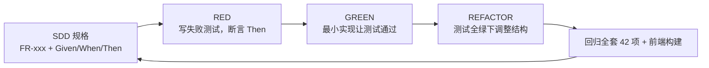

# LiteTrain TDD 测试规格与验收矩阵

| 项 | 内容 |
| --- | --- |
| 文档版本 | v1.0 |
| 日期 | 2026-11-22 |
| 对应需求 | `docs/requirements-spec.md` v1.0 |
| 对应设计 | `docs/technical-design.md` v1.0 |
| 方法论 | TDD（测试驱动开发）+ SDD（规格驱动开发） |
| 当前状态 | 后端 **42 项测试通过**；前端 typecheck/build 通过；黑盒 E2E 通过 |

---

## 0. 方法论

### 0.1 TDD 循环



规则：

1. **先写测试再写代码**。没有失败的测试，不允许新增生产代码。
2. **测试断言规格的 `Then`**，不断言实现细节。例如断言「allocation 被释放」，而不是断言「调用了 `release_allocation()`」。
3. **每次只前进一小步**。红灯 → 绿灯的间隔应小于一个可提交单元。
4. **重构必须有绿灯保护**。安全抽取、重命名、去重复都允许；改变行为的改动必须先回到红灯。
5. **回归必须全绿**。任何提交都要让 42 项测试与前端构建同时通过。

### 0.2 测试金字塔

| 层 | 数量 | 工具 | 速度 | 目标 |
| --- | --- | --- | --- | --- |
| 单元 | 4 | pytest | 毫秒级 | 纯函数：ANSI 清理、offset 计算、manifest 拷贝 |
| 集成 | 38 | pytest + FastAPI `TestClient` + 临时 SQLite | 秒级 | API、状态机、调度、watchdog、P2 行为 |
| 黑盒 E2E | 2 脚本 | 真实 Ray + HTTP | 分钟级 | 真实训练、SSE、Webhook 回调、产物下载 |
| 前端 | 构建 + 截图 | `vue-tsc`、`vite build`、Playwright | 分钟级 | 类型安全、可构建、真实页面 |

> 已知缺口：`frontend/` 目前没有单元测试脚本。前端正确性由 typecheck/build 与 Playwright 真实页面截图保障；这是后续补齐方向。

---

## 1. 测试基建

`backend/tests/conftest.py` 提供：

| Fixture / 辅助 | 作用 |
| --- | --- |
| `tmp_workdir` | `tests/.tmp/<uuid>` 独立目录，测试结束清理；避免 ACL 限制的临时目录问题 |
| `settings` | `environment=test`；独立 SQLite；`execution_mode=local`；关闭 Redis/auth/前端托管 |
| `app` | `create_app(settings, start_scheduler=False)`，测试内手动驱动 tick |
| `client` | FastAPI `TestClient` 上下文，携带 app lifespan |
| `ctx` | `app.state.ctx`，用于直接操作服务与 ORM 对象 |
| `payload` | 标准提交体（yolov8n / coco128 / 1 epoch / 4 CPU） |
| `create_task` | 建 pending 任务并记录 ID |
| `mark_running` | 置 running、写时间戳、建 active allocation，返回 `worker_token` |
| `write_result` | 模拟 worker 写 `result.json`（含 exit_code） |
| `active_allocations` | 查询当前 active 分配，用于断言资源回收 |
| `get_task_model` | 取 ORM 任务对象，便于断言状态/failure_reason/retry_count |

`backend/pytest.ini`：

```ini
pythonpath = .
testpaths = tests
addopts = -q -p no:cacheprovider -p no:tmpdir
```

设计意图：测试可重复、彼此隔离；不依赖真实 Ray 或 Redis；调度器不自动跑，由测试显式调用，使 watchdog 行为可确定断言。

特殊手法：

- 鉴权测试不 mock 中间件，而是构造 `auth_enabled=True` 的 Settings 并真实登录建用户。
- Webhook 用 `monkeypatch.setattr(module.requests, "post", fake_post)` 模拟 HTTP，同时在 `fake_post` 中校验 HMAC 签名。
- 抢占测试用 monkeypatch 替换 `launch` 行为，无需真实 GPU/长训练。

---

## 2. 红灯优先的测试设计

以下给出每个核心机制「先写什么失败测试 → 最小实现 → 重构点」。测试文件与函数名均为仓库中真实存在的用例。

### 2.1 任务创建与分页（FR-TASK-01/02）

**RED** `test_api.py::test_create_list_filter_search_and_pagination`
- Given：标准 payload
- When：提交 → 按状态筛选 → 按 ID/名称搜索 → 翻页
- Then：201 创建成功；筛选结果全部为指定状态；`total` 与页码正确
- 初次运行失败于 `/tasks` 路由不存在。

**GREEN**：在 `api/tasks.py` 增加 POST/GET 路由，直接 `TaskService.create()` 与 ORM 查询。
**REFACTOR**：把筛选条件收敛到 `TaskService.list_tasks()`，路由只做参数解析。

### 2.2 增量日志（FR-LOG-01/02）

**RED** `test_logs.py::test_incremental_byte_offsets_and_ansi_stripping`
- Given：日志含 ANSI 色码和 `\r`
- When：先读一次，再以 `next_offset` 续读
- Then：`content` 无控制字符；第二轮不重复输出；`start_offset` 等于上轮 `next_offset`

**GREEN**：`LogStore.read(offset, limit)` 按 raw 字节切片，展示层 `clean_log_text()`。
**REFACTOR**：把 offset 语义固化为「raw 字节」，避免未来有人改成字符数。

### 2.3 正常退出与失败退出（FR-TASK-05）

**RED** `test_scheduler.py::test_successful_result_marks_succeeded`
- Given：running 任务，`result.json` 的 `exit_code=0`
- When：`scheduler.tick()`
- Then：状态 `succeeded`、`progress=100`、allocation 释放

**RED** `test_scheduler.py::test_nonzero_exit_can_auto_retry`
- Given：`max_retries=1`，非 0 退出
- When：tick
- Then：回到 `pending` 且 `retry_count=1`；旧结果文件被删除

**GREEN**：在 `_watch_running()` 读结果，在 `_finish()` 统一结算/重试/回收。
**REFACTOR**：抽出 `_retry_eligible()`，集中管理不重试的场景。

### 2.4 心跳超时与超时（FR-RESI-01/02）

**RED** `test_scheduler.py::test_heartbeat_timeout_fails_and_releases`
- Given：running 任务，`last_heartbeat_at` 早于阈值 25 秒
- When：tick
- Then：`failed / heartbeat_timeout`，allocation 释放

**RED** `test_scheduler.py::test_runtime_timeout_fails_and_releases`
- Given：`max_runtime_seconds` 很小
- When：多个 tick 后超过阈值
- Then：`failed / runtime_timeout`，allocation 释放

**GREEN**：Watchdog 按「结果 → 超时 → 心跳 → PID 消失」顺序检查。
**REFACTOR**：阈值统一来自 Settings，运行时上限取 `min(task, default)`。

### 2.5 取消（FR-TASK-04）

**RED** `test_api.py::test_cancel_pending_and_conflict`
- Given：一个 pending、一个已终态任务
- When：分别取消
- Then：pending 变 cancelled；终态任务返回 409

**RED** `test_scheduler.py::test_cancel_running_task_releases_resources`
- Given：running 且占 4 CPU
- When：取消
- Then：worker 停止、allocation 释放、状态 cancelled

**GREEN**：`cancel()` 按状态分支；终态检查放在写事务内。
**REFACTOR**：统一事件写入 `task.cancelled`，前端只需消费事件时间线。

### 2.6 资源容量与优先级（FR-SCHED-01/02/04/06）

**RED** `test_scheduler.py::test_capacity_and_priority_queue`
- Given：容量被占满，多个 pending 任务优先级不同
- When：tick
- Then：高优先级排前面；资源不足时低位保持 pending；释放后自动派发

**GREEN**：写事务内 `choose_node()` + 用户配额校验 + `priority DESC, submitted_at ASC`。
**REFACTOR**：把账本逻辑集中到 `resources.py`，Scheduler 只负责编排。

### 2.7 抢占（FR-SCHED-05）

**RED** `test_scheduler.py::test_preemption_requires_checkpoint`
- Given：低优先级任务运行但无 checkpoint
- When：高优先级任务资源不足
- Then：不抢占，高优先级保持 pending

**RED** `test_scheduler.py::test_preemption_finalises_original_and_resumes_child`
- Given：低优先级任务有 epoch checkpoint
- When：触发抢占
- Then：原任务 `cancelled/preempted`；新子任务 `resume_from_task_id` 指向原任务、`preempt_count=1`；高优先级下一 tick 运行

**GREEN**：`_preempt_for()` 筛候选 → `_preempt_task()` 终结并 `resume(full)`。
**REFACTOR**：抢占阈值收敛为 `PREEMPT_PRIORITY_GAP=20`、`MAX_PREEMPTIONS=2`。

### 2.8 鉴权与角色（FR-AUTH-01/02）

**RED** `test_auth.py::test_login_is_required_and_roles_are_enforced`
- Then：未登录 401；viewer 读允许、写 403；viewer 访问 admin/settings 403；禁用账号 401；logout 后 401

**GREEN**：`auth_guard` 中间件 + `required_permission()` 映射。
**REFACTOR**：角色权限表集中到 `services/auth.py`。

### 2.9 多节点、数据集、Webhook、流水线（P2）

对应 `test_p2.py` 的 9 项与 `test_quality.py` 的 3 项。红灯设计示例：

- `test_two_node_topology_and_balanced_allocation`：两个 4 CPU 节点各跑一个 3 CPU 任务 → 各占 3/4，合计 6/8。
- `test_webhook_enqueue_sign_and_deliver`：fake_post 校验 `X-LiteTrain-Signature == HMAC-SHA256(secret, timestamp + "." + rawBody)`，返回 204 后 outbox 标记 success。
- `test_pipeline_coordinator_serial_stages`：tick 推进三阶段，全部 succeeded。
- `test_quality_gate_blocks_invalid_labels`：非法标签数据集提交返回 422。

---

## 3. 完整测试清单（42 项）

### `tests/test_api.py`（8）

| 测试函数 | 覆盖需求 |
| --- | --- |
| `test_health_and_overview` | FR-UI-01 |
| `test_options_and_preview` | FR-TASK-01 |
| `test_create_list_filter_search_and_pagination` | FR-TASK-01/02 |
| `test_logs_are_incremental` | FR-LOG-02 |
| `test_cancel_pending_and_conflict` | FR-TASK-04 |
| `test_heartbeat_and_metrics_ingest` | FR-RESI-01、FR-METRIC-01/02 |
| `test_internal_endpoints_reject_non_running_task` | FR-RESI-01（回调鉴权） |
| `test_validation_and_not_found` | FR-TASK-01/03 |

### `tests/test_logs.py`（4）

| 测试函数 | 覆盖需求 |
| --- | --- |
| `test_clean_log_text_strips_ansi_and_normalizes_carriage_returns` | FR-LOG-02 |
| `test_incremental_byte_offsets_and_ansi_stripping` | FR-LOG-02 |
| `test_read_chunk_respects_limit_and_eof` | FR-LOG-02、NFR-01 |
| `test_log_store_handles_missing_file_by_creating_it` | FR-LOG-01 |

### `tests/test_scheduler.py`（10）

| 测试函数 | 覆盖需求 |
| --- | --- |
| `test_runtime_timeout_fails_and_releases` | FR-RESI-02、FR-SCHED-03 |
| `test_heartbeat_timeout_fails_and_releases` | FR-RESI-01、FR-SCHED-03 |
| `test_successful_result_marks_succeeded` | FR-TASK-05、ACC-1 |
| `test_nonzero_exit_can_auto_retry` | FR-RESI-03 |
| `test_cancel_running_task_releases_resources` | FR-TASK-04、FR-SCHED-03 |
| `test_capacity_and_priority_queue` | FR-SCHED-01/02/04/06 |
| `test_retry_then_terminal_failure` | FR-RESI-03 |
| `test_admin_runtime_cap_applies_to_running_task` | FR-CFG-01 |
| `test_preemption_requires_checkpoint` | FR-SCHED-05 |
| `test_preemption_finalises_original_and_resumes_child` | FR-SCHED-05 |

### `tests/test_auth.py`（1）

| 测试函数 | 覆盖需求 |
| --- | --- |
| `test_login_is_required_and_roles_are_enforced` | FR-AUTH-01/02 |

### `tests/test_settings.py`（1）

| 测试函数 | 覆盖需求 |
| --- | --- |
| `test_runtime_settings_update_and_task_defaults` | FR-CFG-01 |

### `tests/test_manifest_resume.py`（6）

| 测试函数 | 覆盖需求 |
| --- | --- |
| `test_checkpoint_ingest_and_resume` | FR-RESI-03、FR-SCHED-05 |
| `test_compare_tasks_uses_manifest_and_dataset` | NFR-06 |
| `test_task_distribution_time_windows` | FR-UI-01 |
| `test_rerun_clones_finished_task` | FR-TASK-01 |
| `test_unregistered_dataset_cannot_bypass_quality_gate` | FR-ASSET-01 |
| `test_resume_artifacts_are_copied_to_new_run` | FR-ASSET-02 |

### `tests/test_quality.py`（3）

| 测试函数 | 覆盖需求 |
| --- | --- |
| `test_quality_gate_blocks_invalid_labels` | FR-ASSET-01 |
| `test_quality_gate_and_manifest_for_valid_dataset` | FR-ASSET-01 |
| `test_quality_detects_split_leakage` | FR-ASSET-01 |

### `tests/test_p2.py`（9）

| 测试函数 | 覆盖需求 |
| --- | --- |
| `test_dataset_registry_and_upload` | FR-ASSET-01 |
| `test_artifact_scan_and_download` | FR-ASSET-02 |
| `test_webhook_enqueue_sign_and_deliver` | FR-HOOK-01 |
| `test_two_node_topology_and_balanced_allocation` | FR-SCHED-07 |
| `test_webhook_retry_then_success` | FR-HOOK-01 |
| `test_task_cpu_must_fit_a_single_node` | FR-SCHED-07 |
| `test_pipeline_coordinator_serial_stages` | FR-PIPE-01 |
| `test_pipeline_failure_stops_later_stages` | FR-PIPE-01 |
| `test_pipeline_cancel` | FR-PIPE-01 |

合计 **42 项**。

---

## 4. 需求 → 测试追溯矩阵

| 需求组 | 主要测试文件 | 关键测试函数 |
| --- | --- | --- |
| FR-TASK-01/02/03 | `test_api.py` | `test_create_list_filter_search_and_pagination`、`test_validation_and_not_found` |
| FR-TASK-04 | `test_api.py`、`test_scheduler.py` | `test_cancel_pending_and_conflict`、`test_cancel_running_task_releases_resources` |
| FR-TASK-05 | `test_scheduler.py` | `test_successful_result_marks_succeeded` |
| FR-SCHED-01/02/04/06 | `test_scheduler.py` | `test_capacity_and_priority_queue` |
| FR-SCHED-03 | `test_scheduler.py` | `test_cancel_running_task_releases_resources`、两个 timeout 用例 |
| FR-SCHED-05 | `test_scheduler.py`、`test_manifest_resume.py` | `test_preemption_*`、`test_checkpoint_ingest_and_resume` |
| FR-SCHED-07 | `test_p2.py` | `test_two_node_topology_and_balanced_allocation`、`test_task_cpu_must_fit_a_single_node` |
| FR-RESI-01/02/03 | `test_scheduler.py` | 两个 timeout、`test_nonzero_exit_can_auto_retry`、`test_retry_then_terminal_failure` |
| FR-RESI-04 | 重启黑盒实测 | `scripts/e2e_live.py` + 手动杀 API 进程 |
| FR-LOG-01/02 | `test_logs.py`、`test_api.py` | `test_incremental_byte_offsets_and_ansi_stripping`、`test_logs_are_incremental` |
| FR-LOG-03/04 | 黑盒 + 截图 | `scripts/e2e_live.py`、`docs/screenshots/` |
| FR-METRIC-01/02/03 | `test_api.py` | `test_heartbeat_and_metrics_ingest` + 截图 |
| FR-UI-01–04 | `test_api.py` + 截图 | `test_health_and_overview` + Playwright |
| FR-PIPE-01 | `test_p2.py` | 三个 `test_pipeline_*` |
| FR-ASSET-01/02 | `test_quality.py`、`test_p2.py`、`test_manifest_resume.py` | `test_quality_gate_*`、`test_artifact_scan_and_download` |
| FR-HOOK-01 | `test_p2.py` | `test_webhook_enqueue_sign_and_deliver`、`test_webhook_retry_then_success` |
| FR-AUTH-01/02 | `test_auth.py` | `test_login_is_required_and_roles_are_enforced` |
| FR-CFG-01 | `test_settings.py`、`test_scheduler.py` | `test_runtime_settings_update_and_task_defaults`、`test_admin_runtime_cap_applies_to_running_task` |

---

## 5. 验收基准映射

| 命题验收基准 | 规格条目 | 自动测试 | 黑盒/人工验证 |
| --- | --- | --- | --- |
| 1. 正常提交、日志输出、完成变状态、释放资源 | ACC-1 | `test_successful_result_marks_succeeded`、`test_logs_are_incremental` | `e2e_live.py`；截图 `detail.png` |
| 2. 并发排队与释放后自动调度 | ACC-2 | `test_capacity_and_priority_queue` | `e2e_live.py`；截图 `queue.png` |
| 3. 取消排队/运行任务并回收 | ACC-3 | `test_cancel_pending_and_conflict`、`test_cancel_running_task_releases_resources` | 总览 CPU 回落 |
| 4. 超时/僵死自动识别终止 | ACC-4 | `test_runtime_timeout_fails_and_releases`、`test_heartbeat_timeout_fails_and_releases` | `e2e_live.py` watchdog 证据 |
| 5. 前端交互、状态标签、分页筛选 | ACC-5 | `test_create_list_filter_search_and_pagination` | Playwright 24 张截图 |

P1 / P2 加分项映射见 `requirements-spec.md` §7 的 `ACC-P1-*` / `ACC-P2-*` 表。

---

## 6. 黑盒端到端验证

启动 Redis、Ray、后端后执行：

```powershell
.\.venv\Scripts\python scripts\e2e_live.py
```

覆盖：登录 → 提交 → 轮询状态/进度 → SSE 日志 → 取消 → watchdog 证据。

```powershell
.\.venv\Scripts\python scripts\e2e_p2.py
```

覆盖：注册 Webhook → 创建真实三阶段流水线 → 轮询状态 → 产物下载 → 打印签名投递结果。本机实测输出摘要：

```text
pipeline: plb7d3e20732fd
status: pending → running → succeeded
preprocess succeeded · train succeeded · evaluate succeeded
artifacts: best.pt 6484970 · last.pt 6484970 · results.csv · args.yaml
download: 200 6484970 bytes
webhook deliveries: pipeline.succeeded success 204, task.succeeded success 204 ×3
PIPELINE E2E OK
```

多节点实测：两个 4 CPU 节点各承载一个 3 CPU 任务，合计 6/8；第三个 3 CPU 任务排队位置 #1。

重启恢复实测：8 epoch 任务在 12.5% 时杀 API 并重启，状态仍 `running`、allocation 仍 4，最终 `succeeded`。

---

## 7. CI 集成

`.github/workflows/ci.yml` 在 push `main`、PR 和手动触发时运行：

- **Backend tests**：Python 3.13 + CPU PyTorch → `pytest`（42 项）。
- **Frontend typecheck and build**：Node 22 → `npm ci` → `vue-tsc --noEmit` → `vite build`。

依赖由 GitHub Actions 缓存。红灯测试合入即让 CI 失败，符合 TDD 约束。

---

## 8. 一个完整的 TDD 迭代示例：任务超时

1. **规格**（FR-RESI-02 / AC）：超过 `max_runtime_seconds` 必须终止任务并标记 `failed/runtime_timeout`，同时释放 CPU。
2. **RED**：在 `test_scheduler.py` 写 `test_runtime_timeout_fails_and_releases`，用 `mark_running` 建任务并把 `started_at` 调到过去，`write_result` 不写结果；调用 `scheduler.tick()`。首次运行失败：状态仍是 `running`，allocation 仍 active。
3. **GREEN**：在 `_inspect_running()` 增加 `now - started_at > min(task.max_runtime_seconds, settings.default_max_runtime_seconds)` 分支，调用 `_terminate(..., "runtime_timeout")` 并在 `_finish()` 释放 allocation。测试通过。
4. **RED（补场景）**：增加 `test_admin_runtime_cap_applies_to_running_task`，把任务自身超时设得比后台上限大，断言仍按后台上限终止。首次失败。
5. **GREEN**：阈值改为 `min(...)`。通过。
6. **REFACTOR**：把 `failure_reason` 常量与终止逻辑集中，确认 42 项全绿、前端构建通过。
7. **验收**：`e2e_live.py` 在真实训练中制造超时，观察任务变 `failed` 且总览 CPU 回落；截图归档。

---

## 9. 已知缺口与后续

- 前端无单元测试；建议为 `LogTerminal`（虚拟滚动/暂停滚动）和 `TaskListView`（筛选/分页）补 Vitest + Vue Test Utils。
- 重启恢复目前靠手动/脚本实测；建议加入自动化用例，模拟 actor 存活与丢失两条分支。
- Webhook SSRF 防护与 dead-letter 重放尚无测试，属于生产化待办。
- 性能基准（1 秒 tick、大日志 1 MB 分块）只有功能断言，缺少压迫性负载测试。

---

## 10. 变更记录

| 版本 | 日期 | 变更 |
| --- | --- | --- |
| v1.0 | 2026-11-22 | 建立 TDD 红-绿-重构规格、42 项测试清单与命题验收映射 |
