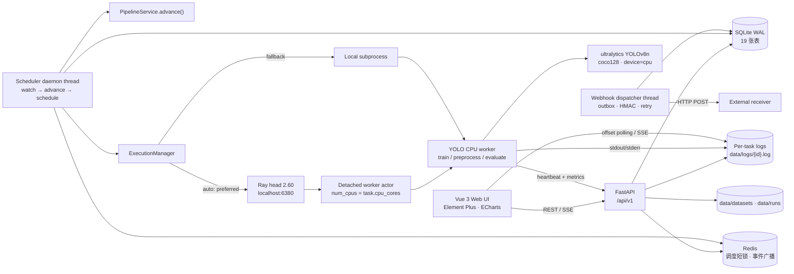
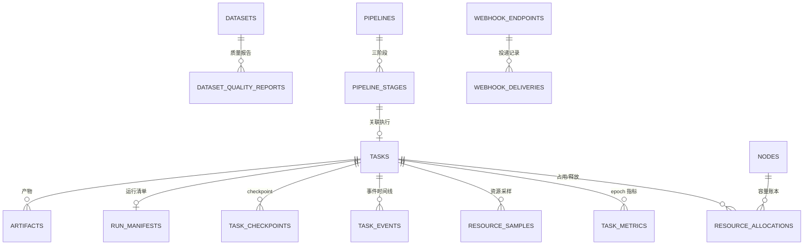
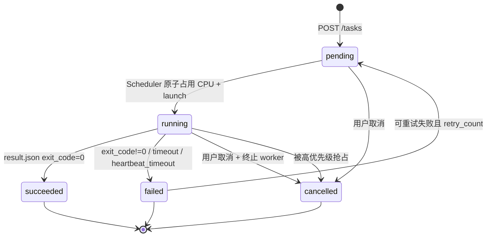
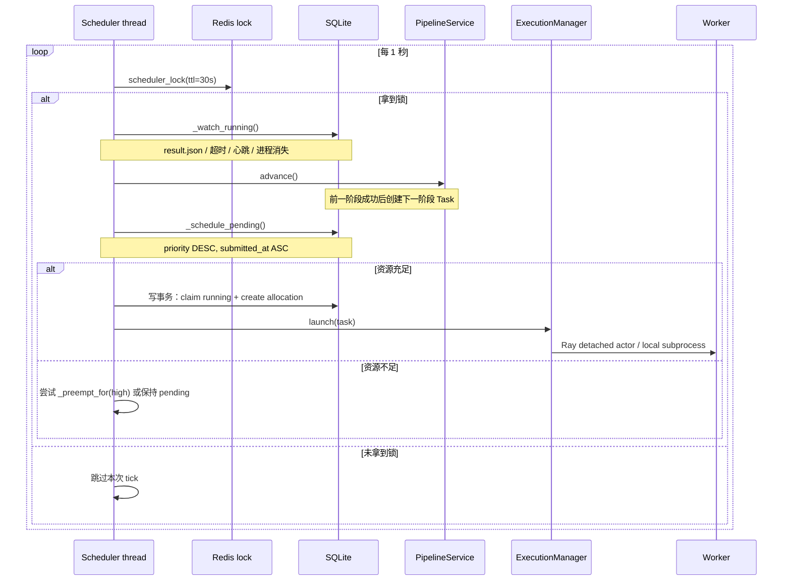
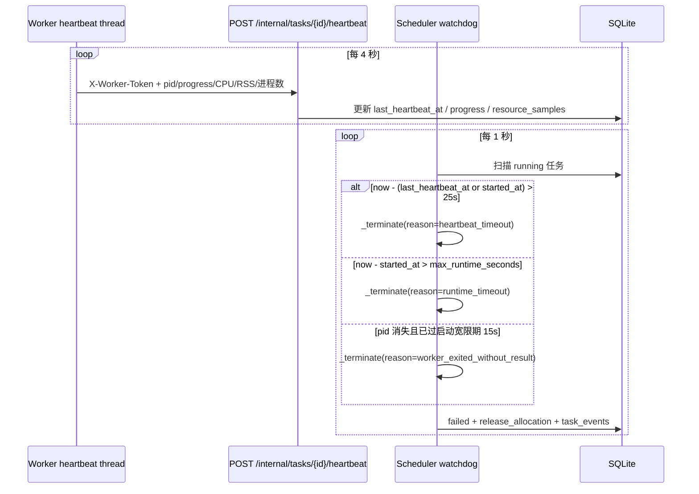

# LiteTrain 技术实现设计文档（SDD + TDD）

| 项 | 内容 |
| --- | --- |
| 文档版本 | v1.0 |
| 日期 | 2026-11-22 |
| 对应需求 | `docs/requirements-spec.md` v1.0 |
| 对应实现 | LiteTrain v2.5.0 |
| 方法论 | SDD（Spec-Driven Development，规格驱动）+ TDD（Test-Driven Development，测试驱动） |
| 文档定位 | 唯一设计事实源；同时承担 Software Design Document 职责 |

---

## 0. 方法论：规格如何变成代码

### 0.1 SDD 链路

```text
需求规格 FR-xxx
   ↓  给出可验证的 Given/When/Then
设计决策（本文第 2、11 章）
   ↓  落到模块、表、接口、状态机
测试规格 TC-xxx（docs/tdd-test-spec.md）
   ↓  红灯先行
最小实现 → 重构 → 绿灯
   ↓
追溯矩阵闭合（需求 §8）
```

本文中所有设计元素都带需求编号回指；任何改动必须先改 `requirements-spec.md` 与 `tdd-test-spec.md`，再改代码。

### 0.2 TDD 约束

每个核心机制按 **红 → 绿 → 重构** 推进：

1. **红**：先写一条会失败的测试，断言的是需求里的 `Then` 子句。
2. **绿**：用最小实现让它通过，禁止提前优化。
3. **重构**：在测试全绿的前提下调整结构（如抽出 `resources.py` 的账本逻辑）。
4. **回归**：每次提交运行 `pytest` 全量套件（当前 42 项）与前端 `vue-tsc --noEmit && vite build`。

详细的红灯用例、测试清单与迭代示例见 [`docs/tdd-test-spec.md`](tdd-test-spec.md)。

---

## 1. 架构总览

### 1.1 系统上下文



### 1.2 分层与职责

| 层 | 目录 | 职责 |
| --- | --- | --- |
| 接入层 | `backend/app/api/` | 路由、参数校验、权限依赖、SSE 响应 |
| 领域服务层 | `backend/app/services/` | 任务 CRUD、调度、资源账本、流水线、数据集、产物、Webhook、执行器 |
| 训练层 | `backend/app/training/` | worker 进程：心跳、指标、checkpoint、结果落盘 |
| 基础设施层 | `backend/app/config.py` / `database.py` / `models.py` | 配置、会话、ORM 模型 |
| 前端 | `frontend/src/` | 视图、组件、API client、路由、权限与主题 |

### 1.3 进程与线程模型

| 进程/线程 | 数量 | 关键行为 |
| --- | --- | --- |
| Uvicorn/FastAPI | 1 | HTTP 请求；lifespan 初始化 `AppContext` |
| `litetrain-scheduler` 守护线程 | 1 | 每 1 秒 tick；持 Redis 短锁；`_watch_running → pipelines.advance → _schedule_pending` |
| Webhook dispatcher 守护线程 | 1 | 每 1 秒扫描 outbox，指数退避重投 |
| Worker 心跳守护线程 | 每任务 1 | 每 4 秒上报进程树资源与进度 |
| Ray actor | 每 attempt 1 | `lifetime="detached"`，确定性名字，API 重启后可重新附着 |
| 训练子进程 | 每 attempt 1 | 由 actor 拉起 `python -m app.training.worker` |

---

## 2. 技术选型与理由

| 组件 | 选型 | 理由 | 对应需求 |
| --- | --- | --- | --- |
| 后端框架 | FastAPI + Pydantic | 自动生成 OpenAPI，参数校验适合任务表单；SSE 原生支持 | FR-TASK-01 |
| 元数据库 | SQLite（WAL） | 题目指定；单机演示足够；写事务保证状态与配额一致性 | NFR-02/03 |
| 调度互斥 | Redis 短锁（TTL 30s） | 多 API 实例互斥；不可用时自动降级为进程内锁 | FR-SCHED-02 |
| 执行核心 | Ray Core 2.60 detached actor | 进程隔离 + `num_cpus` 预留 + API 重启可附着 + 可主动 stop | FR-RESI-04 |
| 训练框架 | ultralytics YOLOv8n，CPU | 题目指定；coco128 示例数据；回调可采指标 | NFR-07 |
| 前端 | Vue 3 + Vite + TS + Element Plus | 题目指定；ECharts 画指标曲线 | FR-UI-01–04 |
| 日志传输 | 字节 offset 轮询 + SSE | 增量、可恢复、不一次性加载全文 | FR-LOG-02/03 |

> 题目允许直接封装 `ray job submit`，本项目选择 Ray Core actor，理由见 ADR-01。

---

## 3. 领域模型与数据库设计

### 3.1 核心 ER 关系



### 3.2 表清单（19 张）

定义位置：`backend/app/models.py`。枚举 `TaskStatus = pending/running/succeeded/failed/cancelled`（`terminal` 属性判定终态）、`AllocationState = active/released`。

| 分组 | 表 | 关键字段与约束 |
| --- | --- | --- |
| 任务 | `tasks` | `id` String(24) PK；`name/owner/status/priority`（索引）；`model/dataset/epochs/imgsz/batch/workers/device/command`；`cpu_cores/compute_threads/cache_mode/seed/patience/save_period/max_runtime_seconds/max_retries/retry_count`；`dataset_id`（索引）/`dataset_sha256/config_json`；`resume_from_task_id/resume_mode/checkpoint_epoch/stop_reason/preempted_by_task_id/preempted_at/preempt_count`；`submitted_at/queued_at/started_at/finished_at/last_heartbeat_at/cancel_requested_at`；`executor/ray_actor_name/pid/pid_create_time/log_path/result_path/worker_token`；`exit_code/failure_reason/progress/latest_cpu_percent/latest_memory_mb`；复合索引 `ix_tasks_status_priority_submitted`、`ix_tasks_owner_status`；属性 `attempt = retry_count + 1` |
| 配置 | `runtime_settings` | `key` PK、`value`、`updated_at` |
| 认证 | `users` | `username` unique、`password_hash`、`role`（admin/operator/viewer）、`active` |
| 认证 | `auth_sessions` | `token_hash` PK、`user_id` FK CASCADE、`expires_at`（索引） |
| 资源 | `nodes` | `name/hostname/total_cpus/status/last_seen` |
| 资源 | `resource_allocations` | `task_id` FK CASCADE、`node_id` FK CASCADE、`cpus`、`state`、`allocated_at/released_at` |
| 观测 | `task_metrics` | `task_id` FK；唯一约束 `(task_id, name, epoch, step)`；索引 `ix_task_metrics_task_epoch` |
| 观测 | `resource_samples` | `task_id` FK；`cpu_percent/memory_mb/process_count/sampled_at` |
| 观测 | `task_events` | `task_id` FK；`event_type/level/message/created_at` |
| 数据 | `datasets` | `name/version` 唯一；`yaml_path/archive_path/content_sha256/image_count/label_count/class_count`；`quality_status/score/report_path/issue_path/acknowledged`；`is_builtin` |
| 数据 | `dataset_quality_reports` | `dataset_id` FK、`status/score/summary_json/report_path/issue_path` |
| 恢复 | `task_checkpoints` | `task_id` FK；唯一 `(task_id, epoch)`；`path/size_bytes/metrics_json/is_best` |
| 复现 | `run_manifests` | `task_id` PK+FK；`manifest_json/dataset_sha256/model_sha256/git_commit` |
| 调优 | `benchmark_runs` | `status/dataset/host_json/matrix_json/selected_json/log_path` |
| 流水线 | `pipelines` | `id/name/owner/status/config_json/failure_reason` + 时间戳 |
| 流水线 | `pipeline_stages` | `pipeline_id` FK、`stage_key/sequence/status`、`task_id` FK SET NULL 且 unique、`uq_pipeline_stage_key` |
| 产物 | `artifacts` | `task_id` FK、`pipeline_id` FK SET NULL、`kind/name/path/size_bytes/sha256`、`uq_artifact_path` |
| Webhook | `webhook_endpoints` | `url/secret/events_json/active` |
| Webhook | `webhook_deliveries` | `endpoint_id` FK、`event_type/status`、`attempts/next_attempt_at`、`response_code`、`ix_webhook_deliveries_pending` |

### 3.3 状态机



约束：不存在第六种状态；抢占不引入 `paused`，原任务直接进 `cancelled/preempted`，进度恢复由新子任务承载。

---

## 4. 核心机制设计

### 4.1 调度循环



关键函数（`$backend/app/services/scheduler.py`）：

| 函数/常量 | 行为 |
| --- | --- |
| `start() / stop() / wake()` | 守护线程生命周期；`_wake_event.wait()` 实现可唤醒等待 |
| `tick()` | 持锁后串行执行 `_watch_running → pipelines.advance → _schedule_pending` |
| `_watch_running() / _inspect_running()` | 终态判定、超时、心跳、PID 消失检查 |
| `_finish()` | 结算终态、释放资源、触发重试、写事件 |
| `_retry_eligible()` | 排除 `runtime_timeout / heartbeat_timeout / cancelled_by_user` |
| `_preempt_for() / _preempt_task()` | 抢占候选筛选与子任务创建 |
| `recover()` / `_recover_one()` | 重启对账与重新附着 |
| `PREEMPT_PRIORITY_GAP=20`、`MAX_PREEMPTIONS=2` | 抢占阈值 |

### 4.2 资源账本与节点选择

唯一资源事实：`SUM(nodes.total_cpus where status=online)` 与 `SUM(resource_allocations.cpus where state=active)`。

调度准入条件（全部满足才派发）：
1. 存在 online 节点且 `node.total_cpus - SUM(active.cpus on node) >= task.cpu_cores`；
2. `user_cpu_quota - SUM(active.cpus for owner) >= task.cpu_cores`；
3. 任务原子状态仍为 `pending`（写事务内再次确认，防双启动）。

节点选择：候选集中取 `SUM(active)/total` 最小的节点，避免连续压满第一节点。任务 CPU 超过最大节点容量时提交阶段直接 422，而非无限排队。拓扑变更要求无 active allocation，且节点总容量不超过 `LITETRAIN_TOTAL_CPUS`。

实现：`app/services/resources.py`；API：`app/api/cluster.py`。

### 4.3 心跳、僵死与超时



内部回调用 `X-Worker-Token` + `hmac.compare_digest` 校验，并要求任务状态为 `running`（否则 409）。Worker 收到 403/404/409 时心跳与指标上报直接 `os._exit(1)`，避免僵尸进程继续训练。

### 4.4 取消、重试、抢占与重启恢复

| 机制 | 触发 | 动作 | 不重试场景 |
| --- | --- | --- | --- |
| 取消 | 用户 API | pending 直接终态；running 先 `ExecutionManager.stop()` 再释放；终态重复取消 409 | 一律不重试 |
| 重试 | `result.json` 非 0 或 worker 异常，`retry_count < max_retries` | 删除 result 与该 attempt 指标 → 重置时间戳 → 回 `pending` → 日志追加分隔线 | `runtime_timeout`、`heartbeat_timeout`、用户取消 |
| 抢占 | 高优先级任务资源不足且优先级差 ≥ 20 | 旧任务 `cancelled/preempted` → `resume(full)` 子任务继承低优先级、`preempt_count+1` → 下 tick 高优先级运行 | 流水线阶段、无 checkpoint、`preempt_count>=2` |
| 重启恢复 | 进程启动 `ctx.initialize()` | 有 result 直接结算；进程存活则刷新心跳并记 `recovered`；否则失败并按规则重试；清理孤儿 allocation | — |

### 4.5 日志管道

```text
worker stdout/stderr
   → 重定向到 data/logs/{task_id}.log（UTF-8）
   → GET /tasks/{id}/logs?offset=N&limit=M
       返回 { content, start_offset, next_offset, file_size, eof }
   → 前端 LogTerminal：SSE 优先，断开退回 offset 轮询
   → ANSI/\r 清洗仅作用于展示层，offset 始终以 raw 字节计
```

约定：`next_offset` 是下一轮请求的唯一合法游标；展示后字符串长度与字节增量不相等是刻意设计（控制字符被清理）。单次 `limit ≤ 1 MB`（配置 `log_chunk_size=65536`）；前端初始只拉 128 KB，虚拟滚动固定行高 22px，最多保留 25,000 行。

实现：`app/services/logs.py`、`app/api/tasks.py`、`frontend/src/components/LogTerminal.vue`。

### 4.6 指标与资源采样

Worker 通过 Ultralytics 回调 `on_train_epoch_start / on_train_batch_end / on_fit_epoch_end` 更新线程安全进度，并在 epoch 结束时：

1. `_collect_metrics()` 从 `trainer.label_loss_items(tloss, prefix="train")`、`trainer.metrics`、`trainer.lr` 抽取有限浮点；
2. 经 `POST /internal/tasks/{id}/metrics` 批量上报，唯一约束保证重复上报幂等；
3. 心跳线程用 psutil 汇总自身 + 子进程 CPU%/RSS/进程数，写入 `resource_samples`；
4. checkpoint 经 `POST /internal/tasks/{id}/checkpoints` 登记（epoch 文件 + `is_best`）。

结果落盘：finally 中停心跳并写 `{task_id, kind, exit_code, error, timestamps, duration, metrics, python}`；`_write_result()` 先写 `.tmp` 再 `os.replace()` 原子替换；最后 `os._exit(exit_code)` 规避 Windows 下 PyTorch/OpenMP 改写退出码。

### 4.7 执行后端：Ray 与本地降级

`ExecutionManager` 按 `LITETRAIN_EXECUTION_MODE` 选择：

| 模式 | 行为 |
| --- | --- |
| `auto` | 探测 Ray GCS `127.0.0.1:6380` 并连接；失败则本地子进程 |
| `ray` | 强制 Ray；创建 `lifetime="detached"`、名字为 `litetrain-task-{task_id}-{attempt}` 的 actor，`num_cpus=task.cpu_cores` |
| `local` | 直接起子进程 |

两种后端使用同一个 `app.training.worker`，所以日志、心跳、指标、重试路径完全一致。Ray 的好处是进程隔离、CPU 预留和 API 重启后 `ray.get_actor()` 重新附着；本地模式没有 Ray 的隔离，但平台账本仍限制并发。

### 4.8 流水线协调

```text
POST /pipelines → 写 pipelines + 3 个 pipeline_stages → 只创建 preprocess Task
Scheduler.tick → PipelineService.advance()
  preprocess succeeded → 创建 train Task（使用生成的数据集）
  train succeeded      → 创建 evaluate Task（使用 best.pt）
  failed/cancelled     → pipeline 终止，后续 stage 置 cancelled
API 重启 → stage/task 状态在 DB，下一 tick 继续推进
```

每个阶段都是普通 Task，因此复用同一套调度、日志、心跳、指标、重试和取消路径；`pipeline_stages.task_id` 是唯一关联点，未修改 Task schema。

### 4.9 Webhook Outbox

1. 状态变更时，业务写与 `webhook_deliveries` 入队在**同一 SQLite 事务**内完成，避免丢事件。
2. Dispatcher 每 1 秒扫描 pending outbox，发 HTTP POST。
3. 请求头：`X-LiteTrain-Event`、`X-LiteTrain-Delivery`（幂等键）、`X-LiteTrain-Timestamp`、`X-LiteTrain-Signature = HMAC-SHA256(secret, timestamp + "." + rawBody)`。
4. 2xx 视为成功；否则按指数退避重试，最多 `LITETRAIN_WEBHOOK_MAX_ATTEMPTS=4` 次。
5. UI 可启停 endpoint、发送 `webhook.test`、查看投递记录与响应码。

---

## 5. API 设计

### 5.1 通用约定

- Base URL：`http://127.0.0.1:8000/api/v1`（`LITETRAIN_API_PREFIX`）。
- 除 `/auth/login` 与 `/internal/*` 外，所有请求需要 `Authorization: Bearer <token>` 或 `litetrain_session` cookie。
- 错误返回统一 JSON `{"detail": "..."}`；`401` 未认证、`403` 越权、`404` 不存在、`409` 状态冲突、`422` 参数/准入失败、`500` 未预期异常。
- 列表统一返回 `{"total": int, "items": [...]}`（分页接口附 `page/page_size`）。

### 5.2 接口清单

**认证与管理**

| 方法 | 路径 | 说明 |
| --- | --- | --- |
| `POST` | `/auth/login` `/auth/logout` | 登录/注销 |
| `GET` | `/auth/me` | 当前账号与权限 |
| `GET/POST` | `/admin/users` | 账号列表/创建 |
| `PATCH` | `/admin/users/{id}` | 角色、启停、重置密码 |
| `GET/PATCH` | `/settings` | 管理员运行策略 |

**任务（FR-TASK / FR-LOG / FR-METRIC）**

| 方法 | 路径 | 说明 |
| --- | --- | --- |
| `POST` | `/tasks` | 提交，201 + task |
| `GET` | `/tasks` | 分页，支持 `status / q / page / page_size / sort_by / sort_order` |
| `GET` | `/tasks/options` `/tasks/preview` | 表单选项/命令预览 |
| `GET` | `/tasks/{id}` | 详情（队列位置、进度、最新资源） |
| `POST` | `/tasks/{id}/cancel` | 取消 |
| `GET` | `/tasks/{id}/logs` | 增量日志（`offset` 字节） |
| `GET` | `/tasks/{id}/logs/stream` | SSE 实时日志 |
| `GET` | `/tasks/{id}/logs/download` | 完整日志下载 |
| `GET` | `/tasks/{id}/events` `/metrics` | 事件时间线/指标 |
| `GET` | `/tasks/{id}/manifest` `/checkpoints` | 运行清单/checkpoint |
| `POST` | `/tasks/{id}/resume` `/rerun` | 断点继续/重跑 |
| `GET` | `/tasks/compare?ids=a,b` | 2–4 任务对比 |

**集群 / 流水线 / 资产 / Webhook**

| 方法 | 路径 | 说明 |
| --- | --- | --- |
| `GET` | `/cluster/overview` `/cluster/nodes` `/cluster/health` | 资源总览、节点、健康 |
| `POST` | `/cluster/nodes/topology` | 替换逻辑节点拓扑 |
| `PATCH` | `/cluster/nodes/{id}` | 上线/下线 |
| `GET` | `/cluster/task-distribution?window=1h` | 状态分布（5m–180d/all） |
| `POST` | `/cluster/benchmarks` | 启动 CPU Benchmark |
| `POST/GET` | `/pipelines` `/pipelines/{id}` | 创建/列表/详情 |
| `POST` | `/pipelines/{id}/cancel` | 取消流水线 |
| `GET/POST` | `/datasets` `/datasets/upload` | 数据集注册/ZIP 导入 |
| `GET/POST` | `/datasets/{id}/quality` `/quality/ack` | 质量报告/确认警告 |
| `GET/DELETE` | `/datasets/{id}/download` `/datasets/{id}` | 下载/软删除 |
| `GET` | `/artifacts` `/artifacts/{id}/download` | 产物列表/下载 |
| `POST/GET/PATCH/DELETE` | `/webhooks` `/webhooks/{id}` | endpoint CRUD |
| `POST` | `/webhooks/{id}/test` | 测试投递 |
| `GET` | `/webhooks/deliveries` | 投递记录 |

**Worker 内部回调**（要求 `X-Worker-Token`，且任务必须 `running`）

| 方法 | 路径 | 说明 |
| --- | --- | --- |
| `POST` | `/internal/tasks/{id}/heartbeat` | 心跳 + 资源采样 + 进度 |
| `POST` | `/internal/tasks/{id}/metrics` | epoch 指标批量入库（幂等） |
| `POST` | `/internal/tasks/{id}/checkpoints` | checkpoint 登记 |

### 5.3 关键接口示例

提交任务（FR-TASK-01）：

```http
POST /api/v1/tasks
Authorization: Bearer <token>
Content-Type: application/json

{
  "name": "coco128 smoke",
  "model": "yolov8n.pt",
  "dataset": "coco128.yaml",
  "epochs": 1,
  "imgsz": 96,
  "batch_size": 4,
  "workers": 0,
  "cpu_cores": 4,
  "priority": 50,
  "max_runtime_seconds": 300,
  "max_retries": 0
}
```

增量日志响应（FR-LOG-02）：

```json
{
  "content": "Epoch 1/1 ...\n",
  "start_offset": 0,
  "next_offset": 4096,
  "file_size": 4096,
  "eof": true
}
```

集群总览（FR-UI-01）：

```json
{
  "total_cpus": 8,
  "allocated_cpus": 4,
  "available_cpus": 4,
  "running_tasks": 1,
  "pending_tasks": 2,
  "user_quota": 8,
  "executor": "ray",
  "redis": "connected",
  "nodes": [{ "id": "node-local-01", "total_cpus": 8, "allocated": 4 }]
}
```

完整接口文档由 FastAPI 在 `/docs` 自动生成；源码位于 `backend/app/api/`。

---

## 6. 前端设计

### 6.1 目录结构

```text
frontend/src/
├─ api/client.ts            # axios 封装：ApiError、token、约 50 个 API 方法、下载/SSE URL
├─ components/
│  ├─ LogTerminal.vue       # SSE + offset 轮询 + 虚拟滚动 + 高亮 + 复制/下载
│  ├─ MetricChart.vue       # ECharts 折线图
│  ├─ MetricsPanel.vue      # 指标与资源面板
│  └─ StatusBadge.vue       # 五种状态标签
├─ composables/             # useAuth / useNotifications / useTheme
├─ layout/AppLayout.vue     # 侧栏 + 顶栏 + 内容区
├─ router/index.ts          # 路由与权限守卫
├─ types/                   # auth.ts / task.ts / p2.ts
├─ views/                   # Overview / TaskList / TaskSubmit / TaskDetail /
│                           # Pipelines / Assets / Admin / Login
├─ styles/index.css
└─ main.ts / App.vue
```

### 6.2 路由与权限

| 路径 | 视图 | 权限 |
| --- | --- | --- |
| `/login` | LoginView | 公开 |
| `/overview` | OverviewView | 登录 |
| `/tasks` | TaskListView | 登录 |
| `/tasks/new` | TaskSubmitView | `platform.submit` |
| `/tasks/:id` | TaskDetailView | 登录 |
| `/pipelines` | PipelinesView | 登录 |
| `/assets` | AssetsView | 登录 |
| `/admin` | AdminView | `admin.console` |

`router.beforeEach` 检查登录态、按 `meta.permission` 校验角色；未登录跳 `/login?redirect=...`。

### 6.3 关键交互

- **任务列表**：状态下拉筛选 + ID/名称搜索 + 分页；操作列含详情、日志、取消（终态禁用）。
- **提交页**：默认 `yolov8n.pt + coco128.yaml + 3 epochs + 160px + 4 CPU`；实时预览 worker 命令与等效 YOLO CLI；一键「快速试跑 1 轮」；提交成功跳 `/tasks`。
- **详情页**：基础信息卡 + 状态徽标 + 事件时间线 + 指标图 + 终端日志；日志支持暂停滚动、关键词高亮、复制、下载。
- **总览页**：CPU 卡片、节点表与进度条、队列/配额/服务状态；多节点拓扑编辑与节点上下线。
- **主题**：Element Plus dark + 自定义 CSS 变量，`localStorage` 持久化；状态变更可通过 Notification API 提示。

---

## 7. 配置管理

配置类 `Settings(BaseSettings)`，`env_prefix="LITETRAIN_"`，读 `backend/.env`，`get_settings()` 带 `lru_cache`。关键项：

| 变量 | 默认值 | 说明 |
| --- | --- | --- |
| `LITETRAIN_TOTAL_CPUS` | `8` | 平台逻辑 CPU 池 / 多节点总预算 |
| `LITETRAIN_USER_CPU_QUOTA` | `8` | 单用户并发上限（校验器约束 ≤ total） |
| `LITETRAIN_EXECUTION_MODE` | `auto` | `auto / ray / local` |
| `LITETRAIN_RAY_GCS_ADDRESS` | `127.0.0.1:6380` | Ray GCS（避开 Redis 6379） |
| `LITETRAIN_REDIS_URL` / `REDIS_PROTOCOL` | `redis://127.0.0.1:6379/0` / `2` | Redis 及兼容模式 |
| `LITETRAIN_SCHEDULER_INTERVAL_SECONDS` | `1.0` | tick 周期 |
| `LITETRAIN_SCHEDULER_LOCK_TTL_MS` | `30000` | 短锁 TTL |
| `LITETRAIN_HEARTBEAT_INTERVAL_SECONDS` | `4` | worker 心跳周期 |
| `LITETRAIN_HEARTBEAT_TIMEOUT_SECONDS` | `25` | 僵死阈值 |
| `LITETRAIN_START_GRACE_SECONDS` | `15` | PID 消失检查宽限期 |
| `LITETRAIN_DEFAULT_MAX_RUNTIME_SECONDS` | `1800` | 任务默认超时 |
| `LITETRAIN_DEFAULT_MAX_RETRIES` | `3` | 默认重试次数（0–5） |
| `LITETRAIN_LOG_CHUNK_SIZE` | `65536` | 单次日志读取上限 |
| `LITETRAIN_AUTH_ENABLED` | `true` | 鉴权开关 |
| `LITETRAIN_BOOTSTRAP_ADMIN_PASSWORD` | `admin123` | 首次管理员密码，生产必须覆盖 |
| `LITETRAIN_WEBHOOK_MAX_ATTEMPTS` | `4` | Webhook 最大投递次数 |

派生属性负责日志/运行/数据/质量/基准目录，`ensure_directories()` 建目录并在 Windows 拷贝 Arial.ttf。管理员通过 `/settings` 修改的运行策略覆盖部分默认值并即时生效。

---

## 8. 安全设计

| 面 | 措施 |
| --- | --- |
| 用户认证 | PBKDF2-SHA256 密码哈希；session token 哈希入库；可注销；Bearer 或 HttpOnly 风格 cookie |
| 权限 | 三角色中间件，按路径+方法映射所需权限；viewer 写操作 403 |
| Worker 回调 | `X-Worker-Token` 由任务创建时生成，不下发前端；`hmac.compare_digest` 比较；状态必须为 running |
| 文件下载 | 校验路径位于允许目录内，防 `../` 路径穿越 |
| Webhook | 仅允许 http(s)；HMAC 签名；投递幂等键；生产需补 SSRF 防护与 secret 加密 |
| 默认口令 | 首次 `admin/admin123`；由环境变量覆盖；文中明确提示 |

---

## 9. 测试策略（TDD 摘要）

完整内容见 [`docs/tdd-test-spec.md`](tdd-test-spec.md)。

| 层 | 工具 | 覆盖 |
| --- | --- | --- |
| 单元/集成 | pytest + FastAPI `TestClient` | 42 项：任务 CRUD、状态机、超时/心跳/重试/抢占、日志 offset、鉴权、P2 |
| 黑盒验收 | `scripts/e2e_live.py` / `e2e_p2.py` | 真实提交、SSE、取消、watchdog、三阶段流水线、Webhook 回调 |
| 前端 | `vue-tsc --noEmit`、`vite build`、Playwright 截图 | 类型、构建、真实页面交互 |
| CI | `.github/workflows/ci.yml` | push/PR 自动跑后端测试与前端构建 |

测试基建 `backend/tests/conftest.py` 提供 `tmp_workdir / settings / app / client / ctx / payload` fixtures，以及 `create_task / mark_running / write_result / active_allocations` 辅助函数。鉴权测试真实登录而非 mock 中间件；Webhook 用 monkeypatch 替换 `requests.post` 并校验签名。

---

## 10. 部署与启动

```powershell
# 1) 依赖
.\scripts\setup.ps1
# 2) Redis（可选，缺失时降级）
Start-Service redis
# 3) Ray head
.\scripts\start_ray.ps1
# 4) 后端（自动建表、注册 COCO128、创建默认节点）
.\scripts\start_backend.ps1
# 5) 前端
.\scripts\start_frontend.ps1
```

- API `http://127.0.0.1:8000`；Swagger `/docs`；健康 `/healthz`；UI `http://127.0.0.1:5173`。
- Linux/macOS 等效手动命令与生产构建（`npm run build` 后由 FastAPI 托管 `frontend/dist`）见根 `README.md`。
- 前端首次登录：`admin / admin123`。
- 数据库迁移：SQLite 可重复执行的加列迁移；升级前备份 `platform.db`。

---

## 11. 关键设计决策（ADR 摘要）

| ID | 决策 | 备选 | 理由 |
| --- | --- | --- | --- |
| ADR-01 | 使用 Ray Core detached actor，不封装 `ray job submit` | `ray job submit` | 需要 API 重启后 `get_actor()` 重新附着、显式停止进程、按任务预留 `num_cpus`；`job submit` 偏 fire-and-forget，取消与重连控制弱。题目两者均允许 |
| ADR-02 | SQLite WAL 而非 Postgres | Postgres | 题目指定；单机演示；写事务已满足一致性。多实例演进需换库，见 `p2-design.md` |
| ADR-03 | 日志 offset 用 raw 字节 | 展示字符数 | 清洗 ANSI 后字符数不稳定；raw offset 单调稳定，续读可恢复 |
| ADR-04 | 多节点为控制面逻辑模拟 | 起多个真实 Ray node | Windows 单机引入端口/对象存储复杂度；模拟的是调度决策与账本，UI 明确标注 |
| ADR-05 | worker 末尾 `os._exit(exit_code)` | `sys.exit` | Windows 下 PyTorch/OpenMP 可能改写进程退出码，导致误判成功/失败 |
| ADR-06 | Webhook 事务性 outbox | 状态变更后异步发 | 防止事件丢失；重试与幂等键在 dispatcher 统一处理 |
| ADR-07 | Redis/Ray 均可降级 | 强依赖 | 普通笔记本演示环境不保证两服务常驻；降级时 UI 明确显示 `LOCAL` / 降级状态 |
| ADR-08 | 抢占以 checkpoint 为粒度 | 进程挂起 | 挂起需要 CRIU 等重机制；checkpoint 恢复跨平台可行，代价是当前 epoch 回退 |

---

## 12. 已知边界与演进

- 抢占只覆盖独立任务且有 checkpoint 的场景；流水线阶段不参与。
- 多节点是控制面模拟，不是跨物理机执行。
- SQLite 不适合多 API 实例共享；生产需 Postgres + 行级锁。
- 流水线固定三阶段，无通用 DAG 编辑器。
- Webhook 未做生产级 SSRF 防护、secret 加密和 dead-letter 重放。
- 数据集为软删除；`data/runs` 需产物保留策略（当前实测已约 807 MB）。
- 认证为单用户演示级别；生产建议 OIDC/JWT、HttpOnly Cookie 和登录限流。
- P1/P2 后续路线（早停、错误分析、ONNX/量化、自动诊断）见 `docs/CPU_OPTIMIZATION_LANDING_PLAN.md`。

---

## 13. 变更记录

| 版本 | 日期 | 变更 |
| --- | --- | --- |
| v1.0 | 2026-11-22 | 基于 v2.5.0 实现回填完整设计，建立 SDD/TDD 追溯与 ADR |
